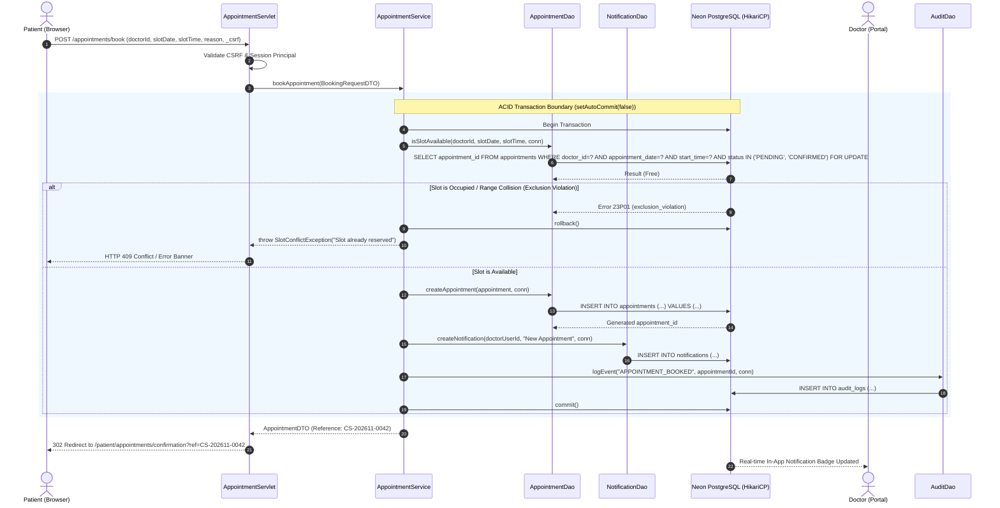

# CareSync — Software Requirements Specification (SRS)

**Document Version:** 1.0.0  
**Status:** Approved for Implementation Planning  
**Target Platform:** Java 21, Jakarta EE 10 (Servlet 6.0, JSP 3.1), Apache Tomcat 10.1, Neon PostgreSQL  
**Author:** Senior Software Architect & Engineering Team  

---

## 1. Introduction

### 1.1 Purpose
This Software Requirements Specification (SRS) details the functional and non-functional requirements for **CareSync**, a modern, multi-tenant-style web-based healthcare management application. CareSync connects patients, healthcare providers (doctors), and clinic administrators within a single cohesive digital ecosystem. This document serves as the formal contractual baseline for system architecture, database schema design, security modeling, and phased implementation.

### 1.2 Scope
CareSync replaces fragmented, paper-based, or legacy desktop hospital management workflows with a cloud-connected web application adhering to modern SaaS design standards. The system provides:
- **Patients:** Real-time doctor search, slot-level appointment booking, complete digital medical records access, prescription management, and post-consultation feedback.
- **Doctors:** Clinical schedule and slot availability management, electronic consultation management, diagnostic notes, digital prescription generation, and patient history review under strict care relationships.
- **Administrators:** Centralized user account governance, credential auditing, doctor credentialing and specialty taxonomy management, clinic-wide appointment tracking, system settings configuration, and tamper-evident audit logs.

### 1.3 Definitions, Acronyms, and Abbreviations
- **RBAC:** Role-Based Access Control
- **DAO:** Data Access Object
- **DTO:** Data Transfer Object
- **JDBC:** Java Database Connectivity
- **HikariCP:** High-performance JDBC connection pool library
- **PBKDF2:** Password-Based Key Derivation Function 2 (with HMAC-SHA256)
- **CSRF:** Cross-Site Request Forgery
- **XSS:** Cross-Site Scripting
- **ACID:** Atomicity, Consistency, Isolation, Durability
- **Neon:** Serverless PostgreSQL cloud platform

---

## 2. Overall Description

### 2.1 Product Perspective
CareSync operates as an independent web application deployed as a Web Application Archive (`.war`) on Apache Tomcat 10.1. It connects to a managed PostgreSQL database hosted on Neon Cloud via HikariCP connection pooling. The system strictly follows a layered **MVC + Service + DAO** pattern with no heavyweight frameworks (e.g., no Spring, no Hibernate/JPA), ensuring high performance, low memory footprint, and transparent architectural compliance with university evaluation rubrics.

```
+-------------------------------------------------------------------------+
|                              Web Browser                                |
|                (HTML5, CSS3, JavaScript, Bootstrap 5, Lucide)          |
+------------------------------------+------------------------------------+
                                     | HTTPS / HTTP
                                     v
+-------------------------------------------------------------------------+
|                        Apache Tomcat 10.1 Engine                        |
|  +-------------------------------------------------------------------+  |
|  | Global Filters (Encoding, Security Headers, Auth, RBAC, CSRF)     |  |
|  +---------------------------------+---------------------------------+  |
|                                    |                                    |
|                                    v                                    |
|  +---------------------------------+---------------------------------+  |
|  | Jakarta Servlets 6.0 (Controllers)                               |  |
|  +---------------------------------+---------------------------------+  |
|                                    |                                    |
|                                    v                                    |
|  +---------------------------------+---------------------------------+  |
|  | Service Layer (Business Logic, Concurrency Controls, DTOs)        |  |
|  +---------------------------------+---------------------------------+  |
|                                    |                                    |
|                                    v                                    |
|  +---------------------------------+---------------------------------+  |
|  | Data Access Objects (DAO Layer, PreparedStatements, Transactions) |  |
|  +---------------------------------+---------------------------------+  |
|                                    |                                    |
|                                    v                                    |
|  +---------------------------------+---------------------------------+  |
|  | HikariCP Connection Pool                                          |  |
|  +---------------------------------+---------------------------------+  |
+------------------------------------+------------------------------------+
                                     | TCP / SSL (JDBC)
                                     v
+-------------------------------------------------------------------------+
|                  Neon Cloud Managed PostgreSQL Database                 |
|               (caresync_db / Role: caresync_app)                         |
+-------------------------------------------------------------------------+
```

### 2.2 User Classes and Characteristics
1. **Patient:** Individual receiving healthcare services. Non-technical to moderately technical users who prioritize simplicity, mobile responsiveness, clear appointment confirmation, and direct access to medical records.
2. **Doctor:** Licensed healthcare practitioner. Fast-paced professional requiring fast data retrieval, intuitive schedule customization, clear consultation logs, and one-click prescription generation.
3. **Administrator:** System manager responsible for institutional integrity, user onboarding, doctor verification, specialty catalogs, and operational monitoring.

### 2.3 Operating Environment
- **Server OS:** Linux (Ubuntu 22.04 LTS / Debian 12 / containerized)
- **Java Runtime:** OpenJDK 21 (LTS)
- **Servlet Container:** Apache Tomcat 10.1.x (Jakarta EE 10 specifications)
- **Database:** PostgreSQL 16 on Neon Cloud
- **Client Browsers:** Modern evergreen browsers (Google Chrome 120+, Mozilla Firefox 120+, Apple Safari 17+, Microsoft Edge 120+)

---

## 3. Specific Functional Requirements (FR Catalog)

### 3.1 Authentication & User Management (AUTH & USR)

| Requirement ID | Module | Title | Description | User Roles |
|---|---|---|---|---|
| **FR-AUTH-001** | Authentication | Patient Self-Registration | System shall allow new patients to create an account with email, password, full name, phone number, date of birth, gender, and blood group. | Anonymous |
| **FR-AUTH-002** | Authentication | Secure Password Hashing | All passwords must be salted with a cryptographically secure random 16-byte salt and hashed using PBKDF2WithHmacSHA256 with a baseline of 600,000 iterations (configurable via environment variables). On successful authentication, if stored iterations are below current target, system automatically rehashes and upgrades the stored hash. Plaintext passwords must never be stored, logged, or cached. | System |
| **FR-AUTH-003** | Authentication | Credential Authentication | System shall authenticate users using email and password, establishing an HTTP session with secure session cookie attributes (`HttpOnly=true`, `SameSite=Lax`, and `Secure=true` in HTTPS environments). | All Roles |
| **FR-AUTH-004** | Authentication | Session Timeout & Invalidation | Active sessions shall automatically expire after 30 minutes of inactivity. Explicit logout shall immediately invalidate the `HttpSession` and clear security contexts. | All Roles |
| **FR-AUTH-005** | Authentication | Account Status Validation | Users with status `INACTIVE` or `SUSPENDED` shall be rejected during login with an explicit, secure notification. | All Roles |
| **FR-AUTH-006** | Authentication | Role-Based Redirection | Upon successful authentication, users must be automatically routed to their role-specific landing dashboard (`/patient/dashboard`, `/doctor/dashboard`, or `/admin/dashboard`). | All Roles |
| **FR-USR-001** | User Profile | View & Update Profile | Users shall be able to view and edit their profile details (e.g., contact phone, address, emergency contact) subject to role constraints. | All Roles |
| **FR-USR-002** | User Profile | Password Change | Authenticated users shall be able to update their password by confirming their current valid password and supplying a compliant new password. | All Roles |

### 3.2 Doctor Management & Catalog (DOC)

| Requirement ID | Module | Title | Description | User Roles |
|---|---|---|---|---|
| **FR-DOC-001** | Doctor Admin | Doctor Account Provisioning | Administrator shall provision doctor accounts, specifying basic user data, medical license number, primary and secondary specialties, years of experience, and consultation fee. | Admin |
| **FR-DOC-002** | Doctor Admin | Doctor Status Lifecycle | Administrator shall activate, suspend, or deactivate doctor accounts without cascading data destruction of historical medical consultations. | Admin |
| **FR-DOC-003** | Doctor Catalog | Specialty Taxonomy | Administrator shall create, update, and toggle active status for medical specialties (e.g., Cardiology, Dermatology, Pediatrics, Neurology). | Admin |
| **FR-DOC-004** | Doctor Profile | Bio & Qualifications Edit | Doctors shall be able to update their professional biography, educational qualifications, consultation room/office, and consultation fee. | Doctor |
| **FR-DOC-005** | Doctor Availability | Schedule Template Definition | Doctors shall define recurring weekly availability rules (e.g., Monday 09:00 - 13:00, 30-minute slots) including break periods and maximum patients per slot. | Doctor |
| **FR-DOC-006** | Doctor Availability | Availability Exceptions & Time-Off | Doctors and Admins shall record full-day leaves, partial-day unavailability windows, emergency leaves, conferences, and clinic-wide holidays in `doctor_availability_exceptions`, dynamically removing affected slots from booking calendars. | Doctor, Admin |
| **FR-DOC-007** | Doctor Directory | Search & Filter Doctors | Patients and guests shall search doctors by name, specialty, consultation fee range, availability day, and minimum experience rating. | Patient, Anon |
| **FR-DOC-008** | Doctor Directory | Doctor Profile Inspection | Patients shall view public doctor profiles displaying credentials, bio, fee, ratings/feedback, and an interactive booking calendar. | Patient, Anon |

### 3.3 Patient Management & Clinical Records (PAT & MED)

| Requirement ID | Module | Title | Description | User Roles |
|---|---|---|---|---|
| **FR-PAT-001** | Patient Admin | Patient Account Directory | Administrator shall search, filter, view details, and toggle account activation status for registered patients. | Admin |
| **FR-PAT-002** | Clinical Records | Medical History Access | Patients shall view their chronological medical history, including past consultations, recorded diagnoses, clinical notes, and attached prescriptions. | Patient |
| **FR-MED-001** | Clinical Records | Record Creation | Doctors shall create a medical record for a completed or active appointment, entering chief complaints, examination observations, formal diagnosis, and clinical recommendations. | Doctor |
| **FR-MED-002** | Clinical Records | Record Immutability | Completed medical records become append-only. Any subsequent amendments must record the authoring doctor's ID and timestamp to preserve legal medical auditability. | Doctor, Admin |
| **FR-MED-003** | Clinical Records | Provider Access Boundaries | Doctors shall only have read access to the complete medical history of patients who have an active, confirmed, or completed appointment with them. Unauthorized browsing of other patients is strictly prevented. | Doctor |

### 3.4 Appointment Lifecycle Management (APT)

| Requirement ID | Module | Title | Description | User Roles |
|---|---|---|---|---|
| **FR-APT-001** | Appointments | Slot Availability Generation | System dynamically computes bookable 30-minute time slots for a given doctor on a requested date based on weekly schedules, existing active appointments, and blackout dates. | Patient, Doctor |
| **FR-APT-002** | Appointments | Slot Reservation & Concurrency | System shall reserve an available appointment slot using a database transaction with pessimistic locking (`SELECT ... FOR UPDATE`) paired with a PostgreSQL range-based GiST exclusion constraint (`ex_no_overlapping_doctor_appointments`) to mathematically prevent overlapping active bookings. | Patient |
| **FR-APT-003** | Appointments | Status State Machine | Appointments must transition strictly according to the defined lifecycle: `PENDING` -> `CONFIRMED` -> `COMPLETED` or `CANCELLED` (or `NO_SHOW`). | System, Doctor, Patient |
| **FR-APT-004** | Appointments | Doctor Workflow Confirmation | Doctors shall view incoming pending appointments and approve (`CONFIRMED`) or decline (`CANCELLED` with reason) according to operational rules. | Doctor |
| **FR-APT-005** | Appointments | Patient Cancellation | Patients may cancel an appointment up to 2 hours prior to the scheduled start time. Cancellations free the slot for other patients. | Patient |
| **FR-APT-006** | Appointments | Doctor/Admin Cancellation | Doctors or Admins may cancel an appointment with an accompanying cancellation justification, automatically triggering an alert to the patient. | Doctor, Admin |
| **FR-APT-007** | Appointments | Completion Transition | A confirmed appointment is transitioned to `COMPLETED` when the doctor submits the consultation record and prescription. | Doctor |

### 3.5 Prescription & Medication Management (RX)

| Requirement ID | Module | Title | Description | User Roles |
|---|---|---|---|---|
| **FR-RX-001** | Prescriptions | Prescription Authoring | Doctors shall generate a structured digital prescription linked to a specific appointment, specifying medicine names, dosage, frequency, route, duration, and special dietary/lifestyle instructions. | Doctor |
| **FR-RX-002** | Prescriptions | Multiple Medication Items | A single prescription header shall support one-to-many medication line items with individual administration schedules. | Doctor |
| **FR-RX-003** | Prescriptions | Patient Prescription Access | Patients shall view and print printable, styled prescription records containing doctor licensing details, clinic header, and medication guidelines. | Patient |
| **FR-RX-004** | Prescriptions | Pharmacological Safety Notes | Doctors can record contraindication warnings and allergy considerations directly on the prescription. | Doctor |

### 3.6 Patient Feedback & Rating System (FBK)

| Requirement ID | Module | Title | Description | User Roles |
|---|---|---|---|---|
| **FR-FBK-001** | Feedback | Verified Consultation Rating | Patients shall be permitted to submit a 1 to 5-star rating and textual review only for appointments that have reached the `COMPLETED` state. | Patient |
| **FR-FBK-002** | Feedback | Single Review Constraint | Each completed appointment allows exactly one submitted review, preventing duplicate vote manipulation. | Patient |
| **FR-FBK-003** | Feedback | Doctor Rating Calculation | System calculates and updates the doctor's average aggregate rating and total review count upon new feedback submission. | System |
| **FR-FBK-004** | Feedback | Admin Moderation | Administrators shall have the authority to flag, hide, or audit abusive or offensive feedback while preserving the record in audit logs. | Admin |

### 3.7 Notifications & Alerts (NOTIF)

| Requirement ID | Module | Title | Description | User Roles |
|---|---|---|---|---|
| **FR-NOTIF-001**| Notifications | In-App Event Notifications | System shall generate in-app notification records for key lifecycle triggers: appointment booked, appointment confirmed, appointment cancelled, prescription issued. | System |
| **FR-NOTIF-002**| Notifications | Unread Indicator & Dismissal | Users shall see an unread notification count badge in the navigation bar and mark notifications as read individually or in bulk. | All Roles |
| **FR-NOTIF-003**| Notifications | Background Reminder Engine | A daemon thread managed by `ScheduledExecutorService` shall scan for upcoming appointments within the next 24 hours and generate reminder alerts. | System |

### 3.8 Administration, Reporting & Audit Logs (ADM & AUD)

| Requirement ID | Module | Title | Description | User Roles |
|---|---|---|---|---|
| **FR-ADM-001** | Admin Portal | Executive Metric Dashboard | Administrator dashboard shall aggregate real-time key metrics: Total Patients, Total Verified Doctors, Today's Appointments, Active Specialties, and Revenue/Booking Volume. | Admin |
| **FR-ADM-002** | Admin Portal | System Configuration Engine | Administrators shall manage key-value system settings (e.g., clinic operating hours, cancellation window limit, max advance booking days) stored in `system_settings`. | Admin |
| **FR-AUD-001** | Audit Log | Security Event Logging | System shall record all critical operations synchronously within the caller's JDBC transaction in an append-only `audit_logs` table (with database-level revocation of `UPDATE` and `DELETE` privileges for the `caresync_app` role and cryptographic SHA-256 hash chaining). | System |
| **FR-AUD-002** | Audit Log | Audit Trail Inspection | Administrators shall search and filter audit records by actor, action type, target entity, and date range. | Admin |

---

## 4. Role-Specific Feature Detailed Workflows

### 4.1 Administrator Workflows

#### Feature: Doctor Onboarding and Verification
- **Description:** Provision a new verified medical practitioner on the platform.
- **User Role:** Administrator
- **Preconditions:** Administrator is authenticated with valid `ADMIN` session.
- **Main Workflow:**
  1. Admin navigates to `/admin/doctors` and clicks "Add New Doctor".
  2. Admin enters user profile info (name, email, temporary password, phone) and professional info (license number, specialty, years of experience, qualification, consultation fee).
  3. System validates email uniqueness and license number format.
  4. System executes a single ACID database transaction:
     - Creates record in `users` with role `DOCTOR` and status `ACTIVE`.
     - Creates record in `doctor_profiles` referencing `user_id`.
     - Inserts record into `audit_logs` capturing `DOCTOR_PROVISIONED`.
  5. System returns success message and displays updated doctor list.
- **Expected Outcome:** Doctor is registered, listed in public directory, and able to log in.
- **Validation Rules:** Email must be RFC 5322 compliant; license number must be non-empty and unique; consultation fee must be >= 0.00.
- **Edge Cases & Errors:**
  - Duplicate email: Transaction rolled back, error banner "Email address is already registered."
  - Database failure during profile insertion: Full rollback, no orphaned user created.

---

### 4.2 Doctor Workflows

#### Feature: Weekly Schedule & Availability Management
- **Description:** Configure recurring weekly operational hours and slot increments.
- **User Role:** Doctor
- **Preconditions:** Doctor is authenticated with status `ACTIVE`.
- **Main Workflow:**
  1. Doctor opens `/doctor/availability`.
  2. System displays current weekly template (days Monday through Sunday).
  3. Doctor selects days of practice (e.g., Tuesday, Thursday), start time (`09:00`), end time (`17:00`), and default slot duration (e.g., `30` minutes).
  4. Doctor saves configuration.
  5. System validates that `start_time` is before `end_time` and duration divides operational window evenly.
  6. Existing future slots with already confirmed appointments are preserved.
  7. System commits changes to `doctor_availability` table.
- **Expected Outcome:** Patients searching for appointments immediately see updated slot availability.
- **Validation Rules:** Slot duration must be one of {15, 20, 30, 45, 60} minutes; start time must precede end time by at least slot duration.
- **Edge Cases & Errors:**
  - Doctor removes a day that already has active confirmed appointments: System blocks removal and displays "Cannot disable Tuesday: 3 existing appointments are booked. Cancel or reschedule them first."

#### Feature: Conducting Consultation & Authoring Prescription
- **Description:** Record clinical diagnosis and medication during/after an appointment.
- **User Role:** Doctor
- **Preconditions:** Appointment exists in status `CONFIRMED`, current user is the assigned doctor.
- **Main Workflow:**
  1. Doctor opens `/doctor/appointments` and selects the patient consultation.
  2. Doctor clicks "Start Consultation" / "Add Medical Record".
  3. Doctor enters symptoms, diagnosis, clinical notes, and adds medication items (name, dosage, frequency, duration).
  4. Doctor submits consultation form.
  5. System initiates a database transaction:
     - Inserts `medical_records` row referencing appointment, doctor, and patient.
     - Inserts `prescriptions` header row.
     - Inserts individual `prescription_items` rows.
     - Updates `appointments.status` to `COMPLETED`.
     - Inserts `notifications` record for the patient.
     - Logs event in `audit_logs`.
  6. Transaction commits.
- **Expected Outcome:** Medical record and prescription are stored permanently; appointment is marked completed; patient can immediately access their records and leave feedback.
- **Validation Rules:** Diagnosis text cannot be empty; at least one clinical observation or medication item must be supplied.

---

### 4.3 Patient Workflows

#### Feature: Doctor Discovery & Appointment Booking
- **Description:** Find a specialist and reserve a verified, non-conflicting consultation slot.
- **User Role:** Patient
- **Preconditions:** Patient is registered and authenticated.
- **Main Workflow:**
  1. Patient visits `/patient/doctors`, filters by specialty (e.g., "Cardiology") and date.
  2. System queries active doctors and presents cards with fee, rating, and next available date.
  3. Patient selects a doctor and views their calendar of open 30-minute slots.
  4. Patient picks an open slot (e.g., 2026-11-15 10:30 AM) and enters symptoms/reason for visit.
  5. Patient clicks "Confirm Booking".
  6. System begins database transaction with `READ COMMITTED` or `SERIALIZABLE` isolation and executes a locking query:
     - Checks if doctor has an active appointment overlapping the slot.
     - Checks if patient already has an active appointment at that time.
     - Inserts appointment row with status `PENDING` (or `CONFIRMED` per system auto-confirm setting).
     - Inserts in-app notification for the doctor.
  7. Transaction commits.
  8. Patient receives booking reference and confirmation view.


- **Expected Outcome:** Appointment is locked; slot disappears from doctor's public open slots.
- **Validation Rules:** Appointment date must be >= current date and <= 60 days in advance. Patient cannot book overlapping appointments.
- **Edge Cases & Errors:**
  - Race condition: Two patients click "Confirm" on the exact same slot at the exact same millisecond. Handled via database unique slot index and transactional row locking. First transaction succeeds; second transaction encounters conflict, rolls back, and returns "This slot was just booked by another patient. Please select another slot."

---

## 5. Non-Functional Requirements (NFR)

### 5.1 Security Requirements
- **NFR-SEC-001 (Password Encryption):** Passwords must be hashed using PBKDF2WithHmacSHA256 with a baseline of 600,000 iterations (configurable via environment variables) and unique 16-byte cryptographically secure salts generated via `SecureRandom`. Automatic work factor upgrade occurs upon successful authentication when configuration increases.
- **NFR-SEC-002 (SQL Injection Defense):** All database interactions must use parameterized `PreparedStatement` queries. No raw SQL string concatenation allowed under any circumstance.
- **NFR-SEC-003 (XSS Defense):** All dynamic output in JSP views must be escaped using JSTL `<c:out value="${...}" />` or custom HTML escaping utilities.
- **NFR-SEC-004 (CSRF Defense):** State-changing HTTP `POST` requests must validate a cryptographically random, per-session synchronizer token.
- **NFR-SEC-005 (Credential Confidentiality):** Database credentials, API tokens, and secret keys must be loaded from server environment variables or a `.env` file outside the web root. No credentials in Git.
- **NFR-SEC-006 (Role-Based Authorization Filter):** Centralized `AuthenticationFilter` and `AuthorizationFilter` must intercept all `/admin/*`, `/doctor/*`, and `/patient/*` routes to prevent Forced Browsing (IDOR).
- **NFR-SEC-007 (Cookie Hardening):** Session cookies must be issued with `HttpOnly=true`, `SameSite=Lax`, and `Secure=true` in HTTPS production deployments.

### 5.2 Performance & Scalability Requirements
- **NFR-PRF-001 (Response Time):** 95% of web requests (HTML views and API endpoints) must render within 250 milliseconds under normal operating load (< 100 concurrent users).
- **NFR-PRF-002 (Neon Serverless & Connection Pool Optimization):** HikariCP connection pool must be configured for Neon scale-to-zero compute: `minimumIdle=0`, `maximumPoolSize=10`, `idleTimeout=600000ms` (10 min), `maxLifetime=1800000ms` (30 min), and `connectionTimeout=30000ms` (accommodating cold-start wakeups). Artificial periodic keepalives are avoided so compute can scale to zero.
- **NFR-PRF-003 (Index Optimization):** All foreign keys, search filters (e.g., `specialty_id`, `doctor_id`, `patient_id`, `appointment_date`, `status`), and GiST exclusion constraints (`slot_range`) must be indexed in PostgreSQL.

### 5.3 Reliability, Availability & Data Integrity
- **NFR-REL-001 (Transaction Atomicity):** Multi-step operations (e.g., booking creation, consultation submission) must execute within an explicit database transaction (`connection.setAutoCommit(false)` ... `commit()` / `rollback()`).
- **NFR-REL-002 (Auditability):** Sensitive modifications to appointments, clinical records, and user status must emit an audit log entry.
- **NFR-REL-003 (Soft Deletion):** Critical clinical entities (doctors, patients, medical records) must use soft-deletion or status flags (`INACTIVE`, `CANCELLED`) to prevent accidental loss of historical health data.

### 5.4 Usability & Accessibility
- **NFR-USE-001 (Responsive Design):** The UI must render seamlessly across desktop (1920x1080), laptop (1366x768), tablet (768x1024), and mobile viewports (375x812) using Bootstrap 5 grid.
- **NFR-USE-002 (Modern Design Tokens):** User interfaces must adhere strictly to the defined color palette: Primary Teal `#176E65`, Soft Teal `#E9F3F2`, Background `#F7F9FA`, Text `#243342`, Surface `#FFFFFF`.
- **NFR-USE-003 (Visual Feedback):** Every form submission must provide clear visual feedback: loading indicators, inline validation errors, and dismissible toast/alert banners.

---

## 6. Business Rules Matrix

| Rule ID | Name | Detailed Business Logic | Enforcing Layer |
|---|---|---|---|
| **BR-001** | Role Exclusivity | A user account belongs to exactly one primary role (`ADMIN`, `DOCTOR`, `PATIENT`). No single login can cross role execution boundaries without explicit re-authentication. | Filter & Service |
| **BR-002** | Care Relationship Boundary | A Doctor can only view clinical records of patients who have had or currently have an appointment assigned to that specific doctor. General patient browsing is forbidden. | Service & DAO |
| **BR-003** | Slot Collision Prevention | A doctor cannot have two active appointments (`PENDING`, `CONFIRMED`) that share an overlapping time range on the same calendar date. Enforced via service-layer 30-min grid alignment and PostgreSQL range exclusion constraint (`ex_no_overlapping_doctor_appointments`). | Database Exclusion Constraint & Transaction |
| **BR-004** | Patient Overlap Prevention | A patient cannot book two simultaneous appointments with different doctors at the same time slot. | Service & Database |
| **BR-005** | Advance Booking Window | Appointments can only be booked between 1 hour in the future and 60 days in advance. Retrospective booking is rejected. | Service Layer |
| **BR-006** | Cancellation Time Limit | A patient can cancel an appointment up to 2 hours before the scheduled time slot. Within 2 hours, cancellation requires contacting the clinic/doctor directly. | Service Layer |
| **BR-007** | Feedback Eligibility | A patient may only submit feedback for an appointment whose status is `COMPLETED`. Exactly one review per appointment is permitted. | Database Unique Constraint & Service |
| **BR-008** | Prescription Integrity | A prescription can only be created by the doctor assigned to the associated appointment, and the appointment must be in `CONFIRMED` or `COMPLETED` status. | Service Layer |
| **BR-009** | Record Preservation | Deactivating or suspending a doctor or patient account must never cascade-delete medical records, audit logs, or billing/prescriptions. | Database Foreign Key Rules (`ON DELETE RESTRICT`) |
| **BR-010** | Status Transition Monotonicity | Appointments can only transition along valid lifecycle arcs (e.g., `COMPLETED` cannot transition back to `PENDING` or `CONFIRMED`). | Service Layer |

---

## 7. System Traceability Matrix

| Requirement ID | Use Case ID | Primary Java Service / Servlet | Target Database Table |
|---|---|---|---|
| FR-AUTH-001 | UC-001 (Patient Registration) | `AuthServlet`, `UserService` | `users`, `patient_profiles` |
| FR-AUTH-003 | UC-002 (User Login) | `AuthServlet`, `UserService` | `users`, `audit_logs` |
| FR-DOC-005 | UC-004 (Doctor Availability) | `AvailabilityServlet`, `DoctorService` | `doctor_availability` |
| FR-DOC-007 | UC-005 (Search Doctors) | `DoctorCatalogServlet`, `DoctorService` | `doctor_profiles`, `specialties` |
| FR-APT-002 | UC-006 (Book Appointment) | `AppointmentServlet`, `AppointmentService`| `appointments`, `notifications` |
| FR-APT-005 | UC-007 (Cancel Appointment) | `AppointmentServlet`, `AppointmentService`| `appointments`, `notifications` |
| FR-MED-001 | UC-009 (Add Medical Record) | `MedicalRecordServlet`, `MedicalRecordService`| `medical_records`, `appointments` |
| FR-RX-001 | UC-010 (Create Prescription)| `PrescriptionServlet`, `PrescriptionService`| `prescriptions`, `prescription_items`|
| FR-PAT-002 | UC-011 (View Medical History)| `MedicalRecordServlet`, `MedicalRecordService`| `medical_records`, `prescriptions` |
| FR-USR-001 | UC-012 (Manage Users) | `AdminUserServlet`, `AdminService` | `users`, `patient_profiles`, `audit_logs`|
| FR-DOC-001 | UC-013 (Manage Doctors) | `AdminDoctorServlet`, `AdminService` | `users`, `doctor_profiles`, `specialties`|
| FR-ADM-001 | UC-014 (Admin Dashboard) | `AdminDashboardServlet`, `AdminService` | Aggregates all tables |
| FR-FBK-001 | UC-015 (Submit Feedback) | `FeedbackServlet`, `FeedbackService` | `feedback`, `doctor_profiles` |
