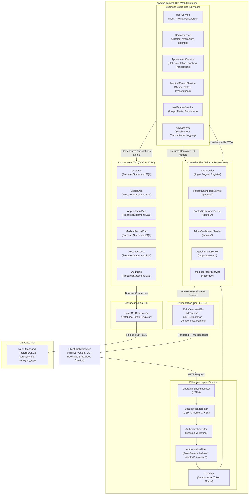

# CareSync — Application Architecture Specification

**Document Version:** 1.0.0  
**Pattern:** Layered Architecture (MVC + Service + DAO)  
**Target Runtime:** Apache Tomcat 10.1 (Jakarta EE 10 / Servlet 6.0 / JSP 3.1)  
**Database:** Neon Cloud PostgreSQL via HikariCP  
**Author:** Senior Software Architect & Java Backend Engineer  

---

## 1. Architectural Overview

CareSync employs a decoupled, enterprise-grade layered architectural pattern (**Model-View-Controller + Service Layer + Data Access Object**). The architecture strictly separates concerns between request dispatching, business domain processing, relational persistence, and presentation rendering.



---

## 2. Package Structure & Responsibilities

The codebase is organized under `com.caresync.*` following clean architecture principles:

```text
com.caresync/
├── config/       # Connection pool, environment loader, global constants
├── model/        # Core domain entities and enums (User, Doctor, Appointment, etc.)
├── dto/          # Data Transfer Objects for web requests, responses, and forms
├── dao/          # Data Access Object interfaces and JDBC implementations
├── service/      # Business logic contracts and transactional implementations
├── servlet/      # Jakarta Servlets (Controllers routing requests and views)
├── filter/       # Interceptor filters (Encoding, Security, Auth, RBAC, CSRF)
├── listener/     # Application & session lifecycle listeners (startup, cleanup, scheduler)
├── exception/    # Custom semantic exception hierarchy and error types
└── util/         # Pure utilities (PasswordHasher, DateTimeUtil, ValidationUtil, etc.)
```

### Detailed Package Analysis

| Package | Purpose & Responsibilities | Key Classes / Interfaces |
|---|---|---|
| `com.caresync.config` | Manages application bootstrap, environment variables (`.env`), database pool configuration (`DatabaseConfig`), and system constants. | `DatabaseConfig.java`, `EnvConfig.java`, `AppConstants.java` |
| `com.caresync.model` | Rich domain entities representing business objects and database tables. Includes entity validation and domain invariants. | `User.java`, `Doctor.java`, `Patient.java`, `Appointment.java`, `Prescription.java`, `Role.java`, `AppointmentStatus.java` |
| `com.caresync.dto` | Decoupled data contracts transferred between view controllers and services. Eliminates leaking internal database schema to the UI. | `LoginRequestDTO.java`, `BookingRequestDTO.java`, `TimeSlotDTO.java`, `DoctorCardDTO.java`, `ApiResponse.java` |
| `com.caresync.dao` | Encapsulates all relational database interaction. Implements JDBC queries using `PreparedStatement`, handles SQL mappings to entities, and isolates persistence. | `GenericDao.java`, `UserDao.java`, `UserDaoImpl.java`, `AppointmentDao.java`, `AppointmentDaoImpl.java` |
| `com.caresync.service` | Encapsulates core business rules, multi-table transactions (`setAutoCommit(false)`), double-booking checks, and audit logging. | `UserService.java`, `UserServiceImpl.java`, `AppointmentService.java`, `AppointmentServiceImpl.java` |
| `com.caresync.servlet` | Controller layer in MVC. Parses incoming HTTP parameters, validates inputs into DTOs, delegates to services, and forwards to JSPs or returns JSON. | `AuthServlet.java`, `PatientServlet.java`, `DoctorServlet.java`, `AdminServlet.java`, `AppointmentServlet.java` |
| `com.caresync.filter` | Chain-of-responsibility filters executed before servlets. Enforces UTF-8 encoding, security headers, authentication, RBAC authorization, and CSRF token checks. | `CharacterEncodingFilter.java`, `AuthenticationFilter.java`, `AuthorizationFilter.java`, `CsrfFilter.java` |
| `com.caresync.listener` | Listens to servlet context and session events. Initializes HikariCP on startup, triggers background `ScheduledExecutorService`, and cleans up on shutdown. | `AppContextListener.java`, `SessionListener.java` |
| `com.caresync.exception` | Semantic application exception hierarchy. Allows services to signal failures cleanly without leaking raw SQL or low-level errors. | `CareSyncException.java`, `SlotConflictException.java`, `AuthenticationException.java`, `ValidationException.java` |
| `com.caresync.util` | Helper classes for cryptographic password hashing, date/time formatting, XSS sanitization, and input validation regexes. | `PasswordUtil.java`, `DateTimeUtil.java`, `ValidationUtil.java`, `SecurityUtil.java` |

---

## 3. Request-Response Lifecycle & Data Flow

Every HTTP request follows a deterministic pipeline through the application stack:

```
[Browser Request]
       |
       v
[CharacterEncodingFilter]  --> Forces UTF-8 on request/response
       |
       v
[SecurityHeaderFilter]     --> Appends X-Content-Type-Options, X-Frame-Options, CSP
       |
       v
[AuthenticationFilter]     --> Checks active session for protected paths (/patient/*, /doctor/*, /admin/*)
       |
       v
[AuthorizationFilter]      --> Verifies user.role matches the route role guard
       |
       v
[CsrfFilter]               --> For POST/PUT/DELETE, verifies _csrf parameter matches session token
       |
       v
[Jakarta Servlet]          --> Extracts params -> binds to DTO -> invokes Service
       |
       v
[Service Layer]            --> Enforces business rules -> coordinates DAOs -> begins JDBC Transaction
       |
       v
[DAO Layer]                --> Acquires pooled Connection -> executes PreparedStatement -> maps ResultSet
       |
       v
[Service commits/rolls back]
       |
       v
[Servlet Receives Result]  --> Sets request attributes (request.setAttribute("appointments", list))
       |
       v
[JSP Rendering Engine]     --> WEB-INF/views/ JSP compiled & rendered via JSTL/EL
       |
       v
[HTTP 200 / HTML Response]
```

### 3.1 Servlets Communicating with Services
Servlets do **not** contain business logic or direct SQL queries. A servlet only handles protocol-specific concerns: extracting request headers, parsing parameters into DTOs, validating input presence, invoking a specific service method, and determining the appropriate response view (JSP forward or JSON redirect).
```java
// Example in AppointmentServlet
BookingRequestDTO requestDto = new BookingRequestDTO(doctorId, patientId, date, time, reason);
try {
    AppointmentDTO appointment = appointmentService.bookAppointment(requestDto);
    request.setAttribute("appointment", appointment);
    request.getRequestDispatcher("/WEB-INF/views/patient/booking-success.jsp").forward(request, response);
} catch (SlotConflictException ex) {
    request.setAttribute("errorMessage", ex.getMessage());
    request.getRequestDispatcher("/WEB-INF/views/patient/book-appointment.jsp").forward(request, response);
}
```

### 3.2 Services Communicating with DAOs & Transaction Management
The Service layer owns business workflows and multi-step transaction boundaries. When an operation requires modifications across multiple tables (e.g., booking an appointment, adding a notification, and logging an audit event), the Service borrows a connection from HikariCP, sets `connection.setAutoCommit(false)`, passes that connection to cooperating DAOs, and calls `commit()` upon completion or `rollback()` upon any `SQLException` or domain exception.

### 3.3 JDBC Connection to Neon PostgreSQL via HikariCP
Connections to Neon Cloud are initialized during Tomcat application boot via `AppContextListener`.
- **Neon Serverless Scale-to-Zero Optimization:** HikariCP is configured with `minimumIdle = 0` and `idleTimeout = 600000ms` (10 minutes). When no clinical activity occurs, HikariCP closes all open pooled connections, allowing Neon serverless compute to gracefully suspend to zero and conserve cloud resources.
- **Cold-Start Connection Recovery:** When a request arrives after Neon compute suspension, HikariCP validates connections using JDBC 4.0 `connection.isValid(5)`. The `connectionTimeout` is configured to `30,000ms`, accommodating Neon's 1-3 second compute wake-up latency without raising timeout errors.
- **No Artificial Keepalives:** CareSync intentionally avoids periodic keepalive pings (`keepaliveTime`), preventing artificial traffic that would block Neon's scale-to-zero mechanism.
- DAOs obtain connections via `DatabaseConfig.getConnection()` inside try-with-resources blocks, ensuring connections are returned to the pool immediately upon statement completion.

### 3.4 View Rendering & Isolation
All JSP views are placed under `/WEB-INF/views/`. Placing JSPs inside `/WEB-INF/` prevents direct browser URL access (e.g., `http://localhost:8080/views/patient/dashboard.jsp` returns HTTP 404). Access is only possible when a verified, authenticated Servlet forwards to the JSP via `RequestDispatcher.forward()`.

---

## 4. Session, Authentication, & RBAC Architecture

### 4.1 Session Strategy
1. **Lifecycle:** Managed by Tomcat's `HttpSession`. Default timeout set to 30 minutes in `web.xml`.
2. **Session Hijacking & Fixation Defense:**
   - On successful authentication, the servlet calls `request.getSession().invalidate()` followed by `request.getSession(true)` to assign a brand new session identifier.
   - Session cookies are issued with `HttpOnly` (inaccessible to JavaScript), `SameSite=Lax`, and `Secure=true` in HTTPS environments (configurable for local dev).
3. **Session Context:** The session holds a lightweight user principal DTO:
   ```java
   public record UserPrincipal(Long userId, String email, String fullName, Role role) {}
   ```

### 4.2 Role-Based Access Control (RBAC) Matrix
The `AuthorizationFilter` intercepts incoming URI paths and enforces access guards:

| URI Pattern | Allowed Roles | Unauthenticated Behavior | Unauthorized Behavior |
|---|---|---|---|
| `/assets/**`, `/login`, `/register`, `/`, `/doctors` | All (Public) | Allowed | Allowed |
| `/patient/**` | `PATIENT` | Redirect to `/login?error=auth_required` | HTTP 403 / Redirect with Access Denied |
| `/doctor/**` | `DOCTOR` | Redirect to `/login?error=auth_required` | HTTP 403 / Redirect with Access Denied |
| `/admin/**` | `ADMIN` | Redirect to `/login?error=auth_required` | HTTP 403 / Redirect with Access Denied |

---

## 5. Complete Physical Project Structure

```text
hospital-management-system/
├── pom.xml
├── README.md
├── .gitignore
├── .env.example
│
├── database/
│   ├── schema.sql
│   ├── seed.sql
│   └── migrations/
│
├── docs/
│   ├── SRS.md
│   ├── architecture.md
│   ├── database-design.md
│   ├── erd.md
│   ├── use-cases.md
│   ├── class-diagram.md
│   ├── security-design.md
│   ├── ui-ux-design.md
│   ├── testing.md
│   ├── rubric-mapping.md
│   ├── implementation-roadmap.md
│   └── phase-0-summary.md
│
└── src/
    ├── main/
    │   ├── java/com/caresync/
    │   │   ├── config/
    │   │   │   ├── AppConstants.java
    │   │   │   ├── DatabaseConfig.java
    │   │   │   └── EnvConfig.java
    │   │   ├── model/
    │   │   │   ├── BaseModel.java
    │   │   │   ├── User.java
    │   │   │   ├── Admin.java
    │   │   │   ├── Patient.java
    │   │   │   ├── Doctor.java
    │   │   │   ├── Specialty.java
    │   │   │   ├── DoctorAvailability.java
    │   │   │   ├── DoctorAvailabilityException.java
    │   │   │   ├── Appointment.java
    │   │   │   ├── MedicalRecord.java
    │   │   │   ├── Prescription.java
    │   │   │   ├── PrescriptionItem.java
    │   │   │   ├── Feedback.java
    │   │   │   ├── Notification.java
    │   │   │   ├── AuditLog.java
    │   │   │   └── SystemSetting.java
    │   │   ├── dto/
    │   │   │   ├── UserPrincipal.java
    │   │   │   ├── LoginRequestDTO.java
    │   │   │   ├── RegisterRequestDTO.java
    │   │   │   ├── BookingRequestDTO.java
    │   │   │   ├── TimeSlotDTO.java
    │   │   │   ├── DoctorCardDTO.java
    │   │   │   ├── ConsultationRequestDTO.java
    │   │   │   ├── AdminStatsDTO.java
    │   │   │   └── ApiResponse.java
    │   │   ├── dao/
    │   │   │   ├── GenericDao.java
    │   │   │   ├── UserDao.java
    │   │   │   ├── UserDaoImpl.java
    │   │   │   ├── DoctorDao.java
    │   │   │   ├── DoctorDaoImpl.java
    │   │   │   ├── DoctorAvailabilityExceptionDao.java
    │   │   │   ├── DoctorAvailabilityExceptionDaoImpl.java
    │   │   │   ├── PatientDao.java
    │   │   │   ├── PatientDaoImpl.java
    │   │   │   ├── AppointmentDao.java
    │   │   │   ├── AppointmentDaoImpl.java
    │   │   │   ├── MedicalRecordDao.java
    │   │   │   ├── MedicalRecordDaoImpl.java
    │   │   │   ├── PrescriptionDao.java
    │   │   │   ├── PrescriptionDaoImpl.java
    │   │   │   ├── FeedbackDao.java
    │   │   │   ├── FeedbackDaoImpl.java
    │   │   │   ├── NotificationDao.java
    │   │   │   ├── NotificationDaoImpl.java
    │   │   │   ├── AuditDao.java
    │   │   │   └── AuditDaoImpl.java
    │   │   ├── service/
    │   │   │   ├── UserService.java
    │   │   │   ├── UserServiceImpl.java
    │   │   │   ├── DoctorService.java
    │   │   │   ├── DoctorServiceImpl.java
    │   │   │   ├── AppointmentService.java
    │   │   │   ├── AppointmentServiceImpl.java
    │   │   │   ├── MedicalRecordService.java
    │   │   │   ├── MedicalRecordServiceImpl.java
    │   │   │   ├── FeedbackService.java
    │   │   │   ├── FeedbackServiceImpl.java
    │   │   │   ├── NotificationService.java
    │   │   │   ├── NotificationServiceImpl.java
    │   │   │   ├── AdminService.java
    │   │   │   └── AdminServiceImpl.java
    │   │   ├── servlet/
    │   │   │   ├── BaseServlet.java
    │   │   │   ├── AuthServlet.java
    │   │   │   ├── HomeServlet.java
    │   │   │   ├── PatientServlet.java
    │   │   │   ├── DoctorServlet.java
    │   │   │   ├── AdminServlet.java
    │   │   │   ├── AppointmentServlet.java
    │   │   │   ├── MedicalRecordServlet.java
    │   │   │   ├── FeedbackServlet.java
    │   │   │   └── NotificationServlet.java
    │   │   ├── filter/
    │   │   │   ├── CharacterEncodingFilter.java
    │   │   │   ├── SecurityHeadersFilter.java
    │   │   │   ├── AuthenticationFilter.java
    │   │   │   ├── AuthorizationFilter.java
    │   │   │   └── CsrfFilter.java
    │   │   ├── listener/
    │   │   │   ├── AppContextListener.java
    │   │   │   └── SessionListener.java
    │   │   ├── exception/
    │   │   │   ├── CareSyncException.java
    │   │   │   ├── AuthenticationException.java
    │   │   │   ├── UnauthorizedException.java
    │   │   │   ├── ResourceNotFoundException.java
    │   │   │   ├── SlotConflictException.java
    │   │   │   ├── ValidationException.java
    │   │   │   └── DatabaseOperationException.java
    │   │   └── util/
    │   │       ├── PasswordUtil.java
    │   │       ├── DateTimeUtil.java
    │   │       ├── ValidationUtil.java
    │   │       ├── SecurityUtil.java
    │   │       └── AppThreadPool.java
    │   │
    │   └── webapp/
    │       ├── assets/
    │       │   ├── css/
    │       │   │   ├── custom.css
    │       │   │   └── bootstrap.min.css
    │       │   ├── js/
    │       │   │   ├── app.js
    │       │   │   ├── booking.js
    │       │   │   └── charts.js
    │       │   └── images/
    │       │       └── logo.svg
    │       └── WEB-INF/
    │           ├── web.xml
    │           └── views/
    │               ├── common/
    │               │   ├── header.jsp
    │               │   ├── footer.jsp
    │               │   ├── navbar.jsp
    │               │   ├── sidebar.jsp
    │               │   ├── alerts.jsp
    │               │   └── error.jsp
    │               ├── auth/
    │               │   ├── login.jsp
    │               │   └── register.jsp
    │               ├── patient/
    │               │   ├── dashboard.jsp
    │               │   ├── profile.jsp
    │               │   ├── doctors-catalog.jsp
    │               │   ├── doctor-details.jsp
    │               │   ├── book-appointment.jsp
    │               │   ├── appointments.jsp
    │               │   ├── medical-history.jsp
    │               │   ├── prescriptions.jsp
    │               │   └── notifications.jsp
    │               ├── doctor/
    │               │   ├── dashboard.jsp
    │               │   ├── profile.jsp
    │               │   ├── availability.jsp
    │               │   ├── appointments.jsp
    │               │   ├── consultation.jsp
    │               │   ├── patient-history.jsp
    │               │   └── feedback.jsp
    │               └── admin/
    │                   ├── dashboard.jsp
    │                   ├── users.jsp
    │                   ├── doctors.jsp
    │                   ├── specialties.jsp
    │                   ├── appointments.jsp
    │                   ├── settings.jsp
    │                   └── audit-logs.jsp
    │
    └── test/
        └── java/com/caresync/
            ├── service/
            ├── dao/
            └── util/
```

