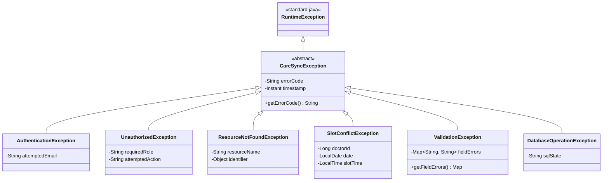

# CareSync — Java Object-Oriented Design & Class Diagram

**Document Version:** 1.1.0  
**Java Version:** OpenJDK 21 (LTS)  
**Architecture:** Object-Oriented Domain Model (MVC + Service + DAO)  
**Author:** Senior Software Architect & Java Backend Engineer  

---

## 1. Object-Oriented Principles in CareSync

CareSync leverages Java 21's modern language capabilities to implement clean, maintainable, and robust Object-Oriented Programming (OOP) principles.

```
                      +-----------------------------+
                      |         <<abstract>>        |
                      |          BaseModel          |
                      |  # id: Long                 |
                      |  # createdAt: Instant       |
                      |  # updatedAt: Instant       |
                      +--------------+--------------+
                                     ^
                                     | extends
                      +--------------+--------------+
                      |             User            |
                      |  - email: String            |
                      |  - passwordHash: String     |
                      |  - passwordSalt: String     |
                      |  - hashIterations: int      |
                      |  - role: Role (Enum)        |
                      |  - status: UserStatus       |
                      +-------+------+-------+------+
                              |      |       |
         +--------------------+      |       +--------------------+
         | extends                   | extends                    | extends
+--------+--------+         +--------+--------+          +--------+--------+
|      Admin      |         |     Doctor      |          |     Patient     |
| - department    |         | - licenseNumber |          | - dateOfBirth   |
| - adminLevel    |         | - specialty     |          | - gender        |
| - accessLevel   |         | - fee: BigDec   |          | - bloodGroup    |
|                 |         | - timeOff: List |          | - emergency     |
+-----------------+         +-----------------+          +-----------------+
         |                           |                            |
         |                           +--------------+-------------+
         |                                          |
         v                                          v
+-----------------+                       +-----------------------------+
|    AuditLog     |                       |         Appointment         |
| - action        |                       | - reference: String         |
| - logHash       |                       | - slotRange: String         |
| - prevLogHash   |                       | - status: AppointmentStatus |
+-----------------+                       +--------------+--------------+
                                                         | 1:1
                                                         v
                                          +-----------------------------+
                                          |         Prescription        |
                                          | - items: List<RxItem>       |
                                          +-----------------------------+
```

### 1.1 Encapsulation
- **Implementation:** All domain entity fields are declared `private` or `protected`. Mutation is controlled via validated getter and setter methods and domain-specific business actions (e.g., `appointment.confirm()`, `appointment.cancel(reason, userId)`).
- **Invariants:** Model objects validate their internal state. For instance, `Doctor.setConsultationFee(BigDecimal fee)` throws `IllegalArgumentException` if `fee.compareTo(BigDecimal.ZERO) < 0`. `User.setHashIterations(int count)` throws `IllegalArgumentException` if `count < 600000`.

### 1.2 Meaningful Inheritance Hierarchy
- **Class Hierarchy:** `BaseModel` -> `User` -> `Admin`, `Doctor`, `Patient`.
  - **`BaseModel`:** Encapsulates entity identity (`id`), audit timestamps (`createdAt`, `updatedAt`).
  - **`User`:** Encapsulates shared credential state (`email`, `passwordHash`, `passwordSalt`, `hashIterations`, `role`, `status`, `firstName`, `lastName`, `phoneNumber`).
  - **`Admin`:** Extends `User` with system-level governance attributes (`adminLevel`, `department`), audit oversight, and permissions (`canManageSystemSettings() = true`, `canAccessAuditLogs() = true`).
  - **`Doctor`:** Extends `User` with clinical attributes (`licenseNumber`, `Specialty`, `consultationFee`, `experienceYears`, `List<DoctorAvailability>`, `List<DoctorAvailabilityException>`).
  - **`Patient`:** Extends `User` with personal health demographics (`dateOfBirth`, `gender`, `bloodGroup`, `address`, `emergencyContactName`, `emergencyContactPhone`).

### 1.3 Polymorphism in Action
- **Polymorphic Routing & Authorization:**
  - `user.getDashboardUrl()`:
    - `Admin.getDashboardUrl()` -> `"/admin/dashboard"`
    - `Doctor.getDashboardUrl()` -> `"/doctor/dashboard"`
    - `Patient.getDashboardUrl()` -> `"/patient/dashboard"`
  - `user.canAccessPatientRecord(Long patientId, CareRelationshipValidator validator)`:
    - `Admin` returns `false` (administrators govern accounts, not private medical notes).
    - `Doctor` returns `validator.hasActiveRelationship(this.getId(), patientId)`.
    - `Patient` returns `this.getId().equals(patientId)`.
- **Interface Decoupling:** Business controllers interact with service contracts (`AppointmentService`, `UserService`), while service logic interacts with DAO interfaces (`GenericDao<T, ID>`, `AppointmentDao`, `DoctorDao`).
- **Method Overriding:** Identity methods (`equals`, `hashCode`, `toString`) are overridden across all domain entities.
- **Method Overloading:** DAOs provide overloaded search methods:
  - `appointmentDao.findByDoctor(Long doctorId)`
  - `appointmentDao.findByDoctor(Long doctorId, LocalDate date)`
  - `appointmentDao.findByDoctor(Long doctorId, LocalDate startDate, LocalDate endDate, AppointmentStatus status)`

---

## 2. Advanced Core Java Concepts Implementation

| Concept | Package & Class | Purpose & University Rubric Value |
|---|---|---|
| **Collections Framework** | `model.*`, `service.*` | `List<PrescriptionItem>` for ordered medications; `Set<DayOfWeek>` for doctor practice days; `List<DoctorAvailabilityException>` for time-off; `Map<LocalDate, List<TimeSlotDTO>>` for slot calendars. |
| **Generics** | `dao.GenericDao<T, ID>`, `dto.ApiResponse<T>`, `dto.PagedResult<T>` | Eliminates type casting, enables reusable boilerplate CRUD DAOs, and guarantees compile-time type safety across database query mappers. |
| **Java Date/Time API (`java.time`)** | `model.*`, `dto.*`, `util.DateTimeUtil` | Replaces obsolete `java.util.Date`. Utilizes `LocalDate` for appointment dates, `LocalTime` for slots, `ZonedDateTime` and `Instant` for UTC audit timestamps, and `Duration` for slot intervals. |
| **Custom Exception Hierarchy** | `exception.*` | Semantic exceptions: `CareSyncException` (base), `AuthenticationException`, `ResourceNotFoundException`, `SlotConflictException` (mapped from PostgreSQL exclusion violation `23P01`), `ValidationException`, `UnauthorizedException`. |
| **Try-with-Resources & AutoCloseable** | `dao.*`, `util.DBUtil` | Prevents connection leaks in Tomcat. Every `Connection`, `PreparedStatement`, and `ResultSet` is automatically closed. |
| **ACID JDBC Transactions** | `service.*`, `dao.*` | Explicit multi-table atomic transactions: `connection.setAutoCommit(false)`, `commit()`, and `rollback()` for booking, consultations, and synchronous audit logging. |
| **Multithreading & Concurrency** | `util.AppThreadPool`, `listener.AppContextListener` | Uses `ScheduledExecutorService` for 15-minute appointment reminder scans; uses `ExecutorService` for non-critical notification delivery. *Critical security audits are executed synchronously within the caller's transaction.* |
| **Thread-Safe Singletons** | `config.DatabaseConfig`, `util.AppThreadPool` | Double-checked locking or Bill Pugh Singleton idiom for connection pool initialization and thread pool lifecycle management. |

---

## 3. Mermaid Class Diagram

```mermaid
classDiagram
    %% Base Model
    class BaseModel {
        <<abstract>>
        #Long id
        #Instant createdAt
        #Instant updatedAt
        +getId() Long
        +setId(Long id) void
        +getCreatedAt() Instant
        +getUpdatedAt() Instant
    }

    %% User Hierarchy
    class User {
        -String email
        -String passwordHash
        -String passwordSalt
        -int hashIterations
        -Role role
        -UserStatus status
        -String firstName
        -String lastName
        -String phoneNumber
        +getFullName() String
        +getDashboardUrl()* String
        +canAccessPatientRecord(Long patientId, Object validator)* boolean
        +isActive() boolean
    }

    class Admin {
        -String department
        -String adminLevel
        +getDashboardUrl() String
        +canAccessPatientRecord(Long patientId, Object validator) boolean
        +canManageSettings() boolean
    }

    class Patient {
        -LocalDate dateOfBirth
        -Gender gender
        -BloodGroup bloodGroup
        -String address
        -String emergencyContactName
        -String emergencyContactPhone
        +getDashboardUrl() String
        +canAccessPatientRecord(Long patientId, Object validator) boolean
        +getAge() int
    }

    class Doctor {
        -Specialty specialty
        -String licenseNumber
        -String qualification
        -int experienceYears
        -BigDecimal consultationFee
        -String bio
        -String roomNumber
        -double averageRating
        -int totalReviews
        -boolean isAvailable
        -List~DoctorAvailability~ availabilities
        -List~DoctorAvailabilityException~ availabilityExceptions
        +getDashboardUrl() String
        +canAccessPatientRecord(Long patientId, Object validator) boolean
    }

    class Specialty {
        -String name
        -String description
        -String iconName
        -boolean isActive
    }

    class DoctorAvailability {
        -int dayOfWeek
        -LocalTime startTime
        -LocalTime endTime
        -int slotDurationMinutes
        -boolean isActive
    }

    class DoctorAvailabilityException {
        -Long doctorId
        -LocalDate exceptionDate
        -boolean isFullDay
        -LocalTime startTime
        -LocalTime endTime
        -String exceptionType
        -String reason
    }

    class Appointment {
        -String referenceNumber
        -Patient patient
        -Doctor doctor
        -LocalDate appointmentDate
        -LocalTime startTime
        -LocalTime endTime
        -AppointmentStatus status
        -String reasonForVisit
        -String cancellationReason
        +canBeCancelledByPatient() boolean
        +isPending() boolean
        +isConfirmed() boolean
    }

    class MedicalRecord {
        -Appointment appointment
        -Patient patient
        -Doctor doctor
        -String symptoms
        -String diagnosis
        -String treatmentPlan
        -String clinicalNotes
    }

    class Prescription {
        -Appointment appointment
        -Patient patient
        -Doctor doctor
        -String generalAdvice
        -List~PrescriptionItem~ items
        +addItem(PrescriptionItem item) void
    }

    class PrescriptionItem {
        -String medicineName
        -String dosage
        -String frequency
        -String duration
        -String instructions
    }

    class Feedback {
        -Appointment appointment
        -Patient patient
        -Doctor doctor
        -int rating
        -String comments
        -boolean isPublished
    }

    class Notification {
        -Long userId
        -String title
        -String message
        -NotificationType type
        -boolean isRead
        +markAsRead() void
    }

    class AuditLog {
        -Long userId
        -String action
        -String targetEntity
        -Long targetId
        -String ipAddress
        -String userAgent
        -String details
        -String logHash
        -String prevLogHash
    }

    %% Enumerations
    class Role {
        <<enumeration>>
        ADMIN
        DOCTOR
        PATIENT
    }

    class UserStatus {
        <<enumeration>>
        ACTIVE
        INACTIVE
        SUSPENDED
    }

    class AppointmentStatus {
        <<enumeration>>
        PENDING
        CONFIRMED
        COMPLETED
        CANCELLED
        NO_SHOW
    }

    %% Realizations & Associations
    BaseModel <|-- User
    BaseModel <|-- Specialty
    BaseModel <|-- DoctorAvailability
    BaseModel <|-- DoctorAvailabilityException
    BaseModel <|-- Appointment
    BaseModel <|-- MedicalRecord
    BaseModel <|-- Prescription
    BaseModel <|-- PrescriptionItem
    BaseModel <|-- Feedback
    BaseModel <|-- Notification
    BaseModel <|-- AuditLog

    User <|-- Admin
    User <|-- Doctor
    User <|-- Patient

    Doctor o-- Specialty : categorizes
    Doctor *-- DoctorAvailability : regularSchedule
    Doctor *-- DoctorAvailabilityException : leavesAndExceptions
    Appointment o-- Patient : bookedBy
    Appointment o-- Doctor : attendedBy
    Appointment *-- MedicalRecord : records
    Appointment *-- Prescription : prescribes
    Prescription *-- PrescriptionItem : lineItems
    Appointment *-- Feedback : reviews

    User --> Role : hasRole
    User --> UserStatus : hasStatus
    Appointment --> AppointmentStatus : hasStatus
```



---

## 4. Custom Exception Class Hierarchy

The project defines a clean, strongly-typed exception hierarchy rooted in runtime unchecked exceptions, allowing clean transaction rollbacks in service methods without boilerplate catch re-throws:


