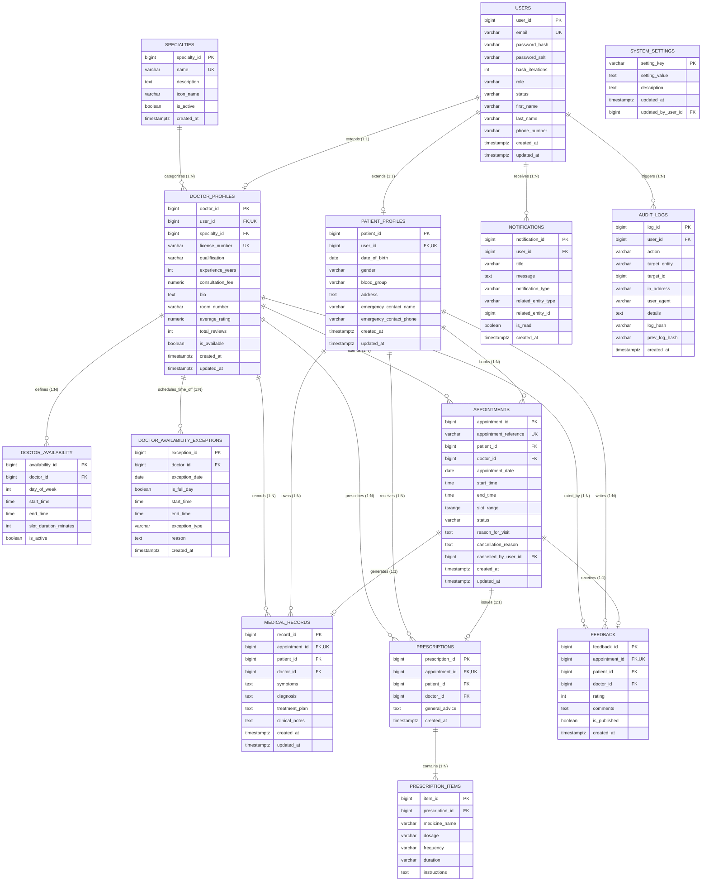

# CareSync — Entity-Relationship Diagram (ERD)

**Document Version:** 1.1.0  
**Database:** `caresync_db` (PostgreSQL 16 on Neon Cloud)  
**Schema Architecture:** 3NF Normalized Relational Design (14 Tables)  

---

## 1. Visual Entity-Relationship Model

---

## 2. Relational Cardinality & Integrity Specifications

| Parent Entity | Child Entity | Cardinality | FK Column | Cascade Action | Rationale |
|---|---|---|---|---|---|
| `users` | `patient_profiles` | 1 : 0..1 | `user_id` | `ON DELETE RESTRICT` | User credentials must not be deleted if demographic profile exists. |
| `users` | `doctor_profiles` | 1 : 0..1 | `user_id` | `ON DELETE RESTRICT` | User credentials must not be deleted if medical credentials exist. |
| `specialties` | `doctor_profiles` | 1 : 0..N | `specialty_id` | `ON DELETE RESTRICT` | A specialty cannot be removed if active doctors are assigned to it. |
| `doctor_profiles` | `doctor_availability` | 1 : 0..N | `doctor_id` | `ON DELETE CASCADE` | Removing a doctor profile removes their weekly schedule rules. |
| `doctor_profiles` | `doctor_availability_exceptions` | 1 : 0..N | `doctor_id` | `ON DELETE CASCADE` | Removing a doctor profile removes their scheduled leaves (NULL doctor_id = clinic holiday). |
| `patient_profiles` | `appointments` | 1 : 0..N | `patient_id` | `ON DELETE RESTRICT` | Patient records cannot be deleted while appointment history exists. |
| `doctor_profiles` | `appointments` | 1 : 0..N | `doctor_id` | `ON DELETE RESTRICT` | Doctor profiles cannot be deleted while consultation history exists. |
| `appointments` | `medical_records` | 1 : 0..1 | `appointment_id` | `ON DELETE RESTRICT` | Legal consultation notes must never be deleted. |
| `appointments` | `prescriptions` | 1 : 0..1 | `appointment_id` | `ON DELETE RESTRICT` | Prescriptions remain immutable audit records of therapy. |
| `prescriptions` | `prescription_items`| 1 : 1..N | `prescription_id`| `ON DELETE CASCADE` | Deleting an unfinalized prescription header removes child medicines. |
| `appointments` | `feedback` | 1 : 0..1 | `appointment_id` | `ON DELETE RESTRICT` | Completed consultation feedback is strictly 1:1. |
| `users` | `notifications` | 1 : 0..N | `user_id` | `ON DELETE CASCADE` | User alerts can be removed if user account is permanently purged. |
| `users` | `audit_logs` | 1 : 0..N | `user_id` | `ON DELETE SET NULL` | Audit logs are permanent; if a user is deleted, log actor becomes NULL. |
