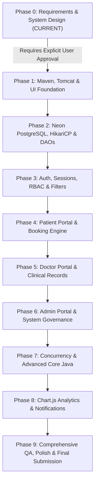

# CareSync — Implementation & Development Roadmap

**Document Version:** 1.0.0  
**Methodology:** Incremental Agile & Milestone-Driven Architecture  
**Target Duration:** Multi-Phase Implementation Plan  
**Author:** Senior Project Architect & Engineering Lead  

---

## 1. Roadmap Architecture Overview

The CareSync implementation spans 10 discrete phases (Phase 0 through Phase 9). Each phase builds upon the verified deliverables of the preceding phase, guaranteeing complete separation of concerns and continuous verification.

> [!WARNING]
> Implementation stops at **Phase 0**. Phase 1 will **not** commence until explicit approval is granted by the user.

---

## 2. Phase-by-Phase Detailed Specifications

---

### Phase 0: Requirements Analysis & System Design
- **Objective:** Establish the comprehensive architectural, database, security, and UI/UX baseline for CareSync without generating application code.
- **Tasks:**
  1. Author Software Requirements Specification (SRS) with functional catalog, business rules, and non-functional requirements.
  2. Model database in 3NF with Neon PostgreSQL schema, constraints, indexes, and Mermaid ERD.
  3. Formulate Java 21 Object-Oriented design, class hierarchy, interfaces, and Mermaid class diagram.
  4. Design MVC + Service + DAO application architecture and request-response lifecycle.
  5. Architect security model: PBKDF2 hashing, session fixation defense, CSRF filter, and RBAC guards.
  6. Define UI design tokens (Primary Teal `#176E65`, Soft Teal `#E9F3F2`), typography, and wireframes.
  7. Formulate university rubric mapping for 33 marks.
  8. Develop comprehensive testing strategy and implementation roadmap.
- **Expected Deliverables:** `docs/SRS.md`, `docs/architecture.md`, `docs/database-design.md`, `docs/erd.md`, `docs/use-cases.md`, `docs/class-diagram.md`, `docs/security-design.md`, `docs/ui-ux-design.md`, `docs/testing.md`, `docs/rubric-mapping.md`, `docs/implementation-roadmap.md`, `docs/phase-0-summary.md`, `README.md`.
- **Dependencies:** None.
- **Acceptance Criteria:** All documentation files created; zero contradictory rules; zero placeholder sections; valid Mermaid diagrams.
- **Testing Requirements:** Documentation review and traceability audit.

---

### Phase 1: Maven Foundation, Tomcat & Frontend Skeleton
- **Objective:** Bootstrap the Java 21 / Jakarta EE 10 Maven project and establish responsive HTML5/Bootstrap 5 layouts.
- **Tasks:**
  1. Create `pom.xml` with dependencies: `jakarta.servlet-api:6.0.0`, `jakarta.servlet.jsp-api:3.1.0`, `jakarta.servlet.jsp.jstl:3.0.0`, `org.postgresql:postgresql:42.7.2`, `com.zaxxer:HikariCP:5.1.0`, `org.junit.jupiter:junit-jupiter:5.10.2`, `org.mockito:mockito-core:5.11.0`.
  2. Configure `web.xml` with session timeouts, error pages, and welcome files.
  3. Set up directory hierarchy (`src/main/java`, `src/main/webapp/WEB-INF/views`, `src/main/webapp/assets`).
  4. Integrate Bootstrap 5.3, Lucide Icons, and compile custom CSS tokens (`custom.css`).
  5. Build reusable JSP partials (`header.jsp`, `footer.jsp`, `navbar.jsp`, `sidebar.jsp`, `alerts.jsp`).
  6. Verify Tomcat 10.1 deployment of a sample landing page.
- **Expected Deliverables:** Compilable Maven project, base JSP templates, assets pipeline.
- **Dependencies:** Approved Phase 0.
- **Acceptance Criteria:** `mvn clean package` generates valid `.war`; renders landing page on Tomcat 10.1.

---

### Phase 2: Neon PostgreSQL Integration, HikariCP & DAO Foundation
- **Objective:** Provision cloud database, execute DDL schema, and build robust JDBC DAO layer with HikariCP configured for Neon serverless scale-to-zero.
- **Tasks:**
  1. Author `database/schema.sql` (14 tables, PostgreSQL range-based GiST exclusion constraints with `btree_gist`, checks, indexes) and `database/seed.sql` (demo doctors, specialties).
  2. Implement `DatabaseConfig.java` with HikariCP connection pool configured for Neon scale-to-zero (`minimumIdle = 0`, `maximumPoolSize = 10`, `idleTimeout = 600000ms`, `connectionTimeout = 30000ms`).
  3. Create `GenericDao<T, ID>` and abstract `BaseDao`.
  4. Implement `UserDao`, `PatientDao`, `DoctorDao`, `SpecialtyDao`, `DoctorAvailabilityExceptionDao`, `AppointmentDao`.
  5. Test connection pooling, serverless SSL connectivity, cold-start recovery, and transaction rollback mechanics.
- **Expected Deliverables:** Executable SQL scripts, functional HikariCP pool, DAO implementations with JUnit integration tests.
- **Dependencies:** Phase 1.
- **Acceptance Criteria:** Successful query execution against Neon PostgreSQL; zero connection leaks in stress test; graceful cold-start recovery without keepalive pings.

---

### Phase 3: Authentication, Sessions, Security Filters & RBAC
- **Objective:** Implement secure user registration, PBKDF2 login (600,000 iterations), session management, hardened cookies, and filter interceptors.
- **Tasks:**
  1. Implement `PasswordUtil.java` using `PBKDF2WithHmacSHA256` (600,000 iterations baseline, unique 16-byte `SecureRandom` salt, constant-time verification, and automatic work factor hash upgrade).
  2. Implement `CharacterEncodingFilter`, `SecurityHeadersFilter`, `AuthenticationFilter`, `AuthorizationFilter`, and `CsrfFilter`.
  3. Configure hardened session cookies (`HttpOnly=true`, `SameSite=Lax`, `Secure=true` in HTTPS).
  4. Implement `AuthServlet` for login, logout, and patient registration.
  5. Implement session invalidation and role-based redirection to `/patient/dashboard`, `/doctor/dashboard`, `/admin/dashboard`.
  6. Implement synchronous transactional `audit_logs` tracking for authentication events with append-only database permissions.
- **Expected Deliverables:** Functional authentication system, session guard filters, CSRF token validation, synchronous audit logging.
- **Dependencies:** Phase 2.
- **Acceptance Criteria:** Unauthenticated access to protected routes redirected; unauthorized roles receive HTTP 403; passwords securely hashed with 600,000 iterations.

---

### Phase 4: Patient Portal & Appointment Booking Engine
- **Objective:** Build patient discovery, doctor search, slot calculation, and appointment booking with collision prevention.
- **Tasks:**
  1. Build Doctor Directory view (`/patient/doctors`) with multi-criteria filtering (specialty, fee, rating).
  2. Implement dynamic 30-minute time slot generation algorithm in `AppointmentService`.
  3. Implement ACID transactional booking checkout with double-booking prevention in `AppointmentServiceImpl`.
  4. Build patient appointment management (view upcoming/past visits, cancel appointment).
  5. Implement patient medical history and prescription viewer.
- **Expected Deliverables:** Patient dashboard, real-time booking calendar, booking confirmation receipts.
- **Dependencies:** Phase 3.
- **Acceptance Criteria:** Concurrent booking test succeeds without double booking; cancellation rules enforced.

---

### Phase 5: Doctor Portal & Clinical Consultation Workspace
- **Objective:** Implement doctor availability and time-off scheduling, appointment review, clinical documentation, and prescription creation.
- **Tasks:**
  1. Build Doctor Availability and Time-Off UI for recurring weekly hours, slot durations, and exceptions (`doctor_availability_exceptions` for leaves, conferences, and holidays).
  2. Build Doctor Appointments manager (accept/reject pending, today's schedule, mark no-show).
  3. Build Clinical Consultation form (record symptoms, diagnosis, treatment notes).
  4. Implement dynamic digital prescription builder with multiple medication items.
  5. Enforce care relationship authorization (BR-002) when viewing patient history.
- **Expected Deliverables:** Doctor workspace, availability manager, prescription generator.
- **Dependencies:** Phase 4.
- **Acceptance Criteria:** Completed consultation automatically marks appointment `COMPLETED` and creates printable prescription.

---

### Phase 6: Admin Portal & System Governance
- **Objective:** Implement centralized administration, user management, doctor credentialing, and audit inspection.
- **Tasks:**
  1. Build Admin Executive Dashboard with real-time statistics.
  2. Implement Doctor Onboarding & Verification form with license validation.
  3. Build Patient and Doctor user management tables (activate, suspend, deactivate).
  4. Build Specialty Taxonomy CRUD manager.
  5. Build Audit Log viewer with search and date filters.
- **Expected Deliverables:** Admin portal, credentialing engine, audit trail viewer.
- **Dependencies:** Phase 5.
- **Acceptance Criteria:** Admin can provision doctors and toggle user status; all actions logged to `audit_logs`.

---

### Phase 7: Advanced Core Java Concepts & Concurrency
- **Objective:** Enhance platform with advanced Core Java features to maximize academic rubric score.
- **Tasks:**
  1. Implement `ScheduledExecutorService` in `AppContextListener` running background appointment reminders.
  2. Implement `ExecutorService` thread pool for asynchronous notification delivery and audit logging.
  3. Refactor DAO query mappers using Java Generics and Collections Streams.
  4. Implement comprehensive custom exception handling with user-friendly error views.
  5. Demonstrate OOP polymorphism and inheritance in domain methods.
- **Expected Deliverables:** Background daemon threads, thread pool management, stream-based analytics.
- **Dependencies:** Phase 6.
- **Acceptance Criteria:** Clean background thread execution without memory leaks during Tomcat shutdown.

---

### Phase 8: Analytics, Chart.js Dashboards & Real-Time Alerts
- **Objective:** Integrate visual charts, notification badges, and UI refinements.
- **Tasks:**
  1. Integrate Chart.js on Admin dashboard (appointment volume line chart, specialty distribution doughnut).
  2. Integrate Chart.js on Doctor dashboard (monthly patient consultations).
  3. Implement in-app notification dropdown with unread badge counter and mark-as-read actions.
  4. Implement patient feedback and rating system (1-5 stars with average rating calculation).
- **Expected Deliverables:** Interactive charts, live notification drawer, feedback rating system.
- **Dependencies:** Phase 7.
- **Acceptance Criteria:** Charts render dynamically from backend JSON/DTO data; notifications update live.

---

### Phase 9: Comprehensive Testing, Deployment & University Evaluation Prep
- **Objective:** Execute full testing suite, optimize performance, verify deployment on Neon Cloud, and assemble final presentation artifacts.
- **Tasks:**
  1. Execute unit and service test suites (JUnit 5, Mockito).
  2. Run concurrent load test for double-booking prevention.
  3. Verify cross-browser and mobile responsive UI rendering.
  4. Perform security audit (SQL injection, XSS escaping, CSRF verification).
  5. Prepare final university demonstration script, video walkthrough, and submission archive.
- **Expected Deliverables:** Verified test reports, production `.war` package, live demonstration documentation.
- **Dependencies:** Phase 8.
- **Acceptance Criteria:** 100% test pass rate; zero critical security vulnerabilities; full compliance with 33-mark rubric.

