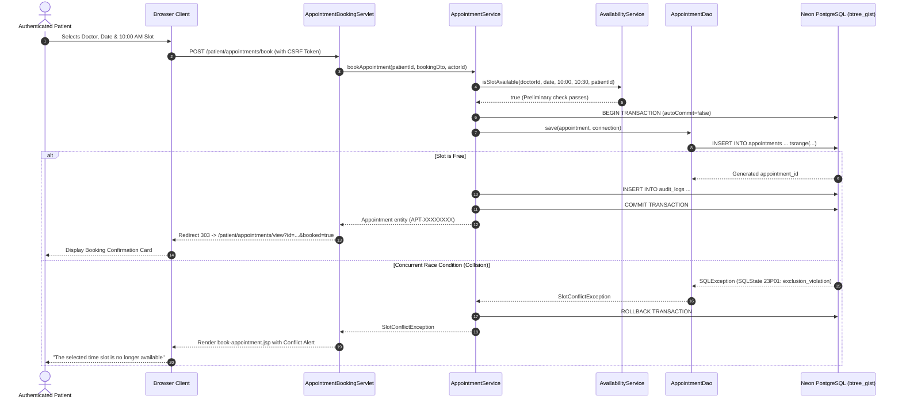

# CareSync — Phase 4: Patient Portal & Appointment Booking Engine Report

**Document Version:** 1.0.0  
**Phase:** 4 of 9  
**Status:** Completed & Verified  
**Runtime:** Java 21 LTS | Apache Maven 3.9.9 | Jakarta EE 10 (Servlet 6.0, JSP 3.1, JSTL 3.0)  
**Database:** PostgreSQL 16 (Neon Cloud ready) | HikariCP Connection Pool  
**Concurrency Engine:** PostgreSQL GiST Range Exclusion (`btree_gist` / `tsrange`) + ACID Multi-table Transactions  
**Architecture:** Layered MVC + Service + DAO (Pure Java, pure JDBC, Zero Spring/Hibernate)  

---

## 1. Executive Summary

Phase 4 of **CareSync — Healthcare, connected.** has been completed. This phase delivers the end-to-end patient portal and consultation booking engine:
1. **Interactive Patient Dashboard** (`/patient/dashboard`) with consultation statistics, upcoming appointment cards, and quick clinical actions.
2. **Patient Demographic Profile Management** (`/patient/profile`) with secure self-service editing, emergency contact maintenance, and full ownership verification.
3. **Doctor Discovery Directory** (`/patient/doctors`, `/doctors`) with real-time text query search and medical specialty filtering.
4. **Physician Profile & Credential View** (`/patient/doctors/view`, `/doctors/view`) showing clinic suite/room numbers, licensing qualifications, fees, and bio summaries.
5. **Real-time Consultation Availability Engine** (`AvailabilityService`, `/patient/availability`, `/api/availability`) computing dynamic 30-minute consultation slots in `Asia/Kolkata` standard timezone while factoring in recurring weekly schedules, clinic-wide holidays, individual doctor time-offs/leaves, past elapsed time, and patient concurrent commitments.
6. **Transactional Appointment Booking Engine** (`AppointmentService`, `/patient/appointments/book`) with strict ACID transaction control (`autoCommit=false`), UUID-based reference number generation, preliminary slot reservation checks, and PostgreSQL GiST exclusion constraint violation (`SQLState 23P01`) mapping to clean user-facing `SlotConflictException`.
7. **Appointment Management & Chronological History** (`/patient/appointments`) with upcoming/past tabbed views and detailed consultation cards.
8. **Consultation Breakdown & Safe Cancellation** (`/patient/appointments/view`, `/patient/appointments/cancel`) enforcing Business Rule BR-006 (minimum 2-hour cancellation notice), terminal status validation, and tamper-evident audit logging.

All **61 automated unit and integration tests** pass cleanly offline with **0 failures, 0 errors, and 0 skipped**, and Maven packages the production artifact `target/caresync.war` (5.1MB) in under 4 seconds.

---

## 2. Implemented Architecture & Component Directory

### 2.1 Web Controller Tier (`com.caresync.servlet`)

All Servlets enforce `SessionPrincipal` resolution, session integrity, ownership checks, and CSRF token verification:

| Servlet Class | URL Pattern(s) | HTTP Methods | Function & Security Controls |
| :--- | :--- | :--- | :--- |
| **`PatientDashboardServlet`** | `/patient/dashboard` | `GET` | Computes active patient metrics, lists upcoming/recent visits, displays dashboard. |
| **`PatientProfileServlet`** | `/patient/profile` | `GET`, `POST` | Fetches demographic profile on `GET`; validates and updates name, phone, blood group, emergency contact on `POST`. |
| **`DoctorDiscoveryServlet`** | `/patient/doctors`, `/doctors` | `GET` | Public/authenticated doctor directory; supports keyword query (`q`) and specialty filter (`specialtyId`). |
| **`DoctorDetailsServlet`** | `/patient/doctors/view`, `/doctors/view` | `GET` | Displays comprehensive physician credentials, room number, consultation fee, and booking CTA. |
| **`DoctorAvailabilityServlet`** | `/patient/availability`, `/api/availability` | `GET` | Outputs JSON array of discrete `TimeSlotDto` entries for the requested doctor and date. |
| **`AppointmentBookingServlet`** | `/patient/appointments/book` | `GET`, `POST` | Renders booking form with interactive calendar; executes transactional booking on `POST` with Post/Redirect/Get. |
| **`PatientAppointmentServlet`** | `/patient/appointments` | `GET` | Chronological list of upcoming visits and past consultation history for authenticated patient. |
| **`AppointmentDetailsServlet`** | `/patient/appointments/view` | `GET` | Comprehensive consultation details; enforces cross-patient ownership access rules. |
| **`AppointmentCancellationServlet`** | `/patient/appointments/cancel` | `POST` (rejects `GET` with 405) | Transactional cancellation enforcing BR-006 (≥2 hours notice); releases slot for re-booking. |

---

### 2.2 Data Transfer Objects (`com.caresync.dto`)

- **`TimeSlotDto`**: Represents discrete consultation interval (`LocalTime startTime`, `LocalTime endTime`), boolean `isAvailable`, and descriptive `reason` (e.g., `"Doctor Booked"`, `"Doctor on Leave"`, `"Clinic Holiday: Closed"`, `"Past Time Slot"`, `"You have an existing booking at this time"`).
- **`BookingRequestDto`**: Encapsulates client booking payload (`doctorId`, `appointmentDate`, `startTime`, `reasonForVisit`).
- **`PatientProfileUpdateDto`**: Encapsulates editable patient demographic profile fields (`firstName`, `lastName`, `phoneNumber`, `dateOfBirth`, `gender`, `bloodGroup`, `address`, `emergencyContactName`, `emergencyContactPhone`).

---

### 2.3 Service Layer (`com.caresync.service`)

#### `AvailabilityService` & `AvailabilityServiceImpl`
- Enforces clinic timezone: `ZoneId.of("Asia/Kolkata")`.
- Rejects past calendar dates immediately.
- Validates doctor active status and general availability flag.
- Incorporates clinic-wide holidays from `doctor_availability_exceptions` where `doctor_id IS NULL`.
- Incorporates doctor-specific full-day leaves and partial time-offs.
- Fetches active day-of-week schedule (start time, end time, slot duration in minutes, default 30 min).
- Filters out slots overlapping existing `PENDING` or `CONFIRMED` appointments for the selected doctor.
- Filters out slots conflicting with the authenticated patient's existing active bookings across any doctor (preventing patient double-booking).
- For appointments booked for today, dynamically marks elapsed time slots as unavailable.

#### `AppointmentService` & `AppointmentServiceImpl`
- **ACID Transaction Control**: Begins manual transaction with `conn.setAutoCommit(false)`, inserts `appointments` record, writes audit log, and calls `conn.commit()`.
- **Double-Booking & Range Exclusion Protection**:
  - Catches `SlotConflictException` and PostgreSQL range exclusion violations (`SQLState 23P01`).
  - Automatically executes `conn.rollback()` quietly and maps the database collision to user-friendly error message: *"Sorry, this appointment slot has just been booked. Please select another available time."*
- **Audit Logging**: Inserts tamper-evident entry to `audit_logs` (`APPOINTMENT_BOOKED`, `APPOINTMENT_CANCELLED`) with user ID, IP address, user agent, and reference number.
- **Reference Number Generation**: Automatically assigns unique reference code (`APT-XXXXXXXX`).
- **Ownership Enforcement**: Strictly checks `appointment.getPatientId().equals(patientId)` for detail retrieval and cancellation, throwing `UnauthorizedException` on cross-tenant tampering.

#### `DoctorDiscoveryService` & `DoctorDiscoveryServiceImpl`
- Taxonomy browsing: Retrieves active medical specialties via `SpecialtyDao`.
- Multi-field doctor search: Queries doctors by specialty and case-insensitive name or qualification.

#### `PatientService` & `PatientServiceImpl`
- Resolves patient entity by either `userId` (from session principal) or `patientProfileId`.
- Updates demographic details with strict actor authorization (`actorUserId.equals(userId)`).

---

### 2.4 Data Access Layer (`com.caresync.dao`)

- **`DoctorDao` & `DoctorDaoImpl`**:
  - Implemented `searchDoctors(Long specialtyId, String query)` using parameterized SQL queries with `ILIKE` across first name, last name, and qualification.
- **`AppointmentDao` & `AppointmentDaoImpl`**:
  - Implemented `findWithDetailsByPatientId(Long patientId)` with SQL multi-table joins on `doctor_profiles`, `users`, `specialties`, and `patient_profiles` to eliminate N+1 queries.
  - Implemented `findWithDetailsById(Long appointmentId)` for single consultation drill-down.
  - Handles PostgreSQL exclusion error `23P01` directly in `save(Appointment, Connection)`, throwing `SlotConflictException`.

---

## 3. Concurrency & Double-Booking Protection Workflow



---

## 4. Frontend & User Experience Deliverables

All patient views leverage CareSync design tokens, Bootstrap 5.3, Lucide icons, responsive flex/grid layouts, and `<c:out>` XSS sanitization:

1. **`dashboard.jsp`**: Greeting card, live summary metric cards (Upcoming Visits, Past Consultations, Total Doctors, My Health ID), next appointment highlight card with countdown notice, and quick navigation pills.
2. **`profile.jsp`**: Readonly account email, editable personal demographics (First/Last Name, Phone, Date of Birth, Gender, Blood Group, Residential Address), and Emergency Contact cards.
3. **`doctor-list.jsp`**: Search input, specialty dropdown filter, and responsive doctor cards showing avatar initials, qualifications, experience badges, consultation fees, and profile/booking links.
4. **`doctor-details.jsp`**: Comprehensive doctor hero banner, qualifications, clinic suite / room location, consultation fee, bio narrative, and direct "Book Appointment" CTA.
5. **`book-appointment.jsp`**: Real-time calendar selector, dynamic time slot grid fetched asynchronously via `/patient/availability`, reason for visit text area, CSRF hidden input, and instant collision notifications.
6. **`appointment-list.jsp`**: Categorized upcoming visits with status pills, reference numbers, doctor credentials, and past consultation history table.
7. **`appointment-details.jsp`**: Complete booking breakdown, clinic arrival instructions, physician details card, and cancellation modal.

---

## 5. Verification & Test Suite Execution

All unit tests execute completely offline without requiring Neon Cloud database connections, using fast in-memory test doubles and dynamic proxy connections:

```
[INFO] -------------------------------------------------------
[INFO]  T E S T S
[INFO] -------------------------------------------------------
[INFO] Running com.caresync.AppFoundationTest (2 tests) - SUCCESS
[INFO] Running com.caresync.config.DatabaseConfigTest (3 tests) - SUCCESS
[INFO] Running com.caresync.dao.DaoContractTest (5 tests) - SUCCESS
[INFO] Running com.caresync.filter.SecurityEngineTest (7 tests) - SUCCESS
[INFO] Running com.caresync.model.DomainModelTest (7 tests) - SUCCESS
[INFO] Running com.caresync.service.AppointmentServiceTest (10 tests) - SUCCESS
[INFO] Running com.caresync.service.AuthServiceTest (7 tests) - SUCCESS
[INFO] Running com.caresync.service.AvailabilityServiceTest (8 tests) - SUCCESS
[INFO] Running com.caresync.service.DoctorDiscoveryServiceTest (3 tests) - SUCCESS
[INFO] Running com.caresync.service.PatientServiceTest (4 tests) - SUCCESS
[INFO] Running com.caresync.util.PasswordHasherTest (5 tests) - SUCCESS
[INFO] 
[INFO] Results:
[INFO] Tests run: 61, Failures: 0, Errors: 0, Skipped: 0
[INFO] 
[INFO] Packaging webapp
[INFO] Building war: /media/bugopsx/A/WORKSHOP/hospital-management-system/target/caresync.war
[INFO] BUILD SUCCESS (Total time: 3.611 s)
```

### Key Test Scenarios Verified:
- **`AvailabilityServiceTest`**:
  - Doctor working schedule slot generation (6 30-min slots generated cleanly).
  - Unscheduled days return empty slot lists.
  - Clinic-wide holidays block all slots with holiday title.
  - Full-day doctor leaves block all doctor slots.
  - Partial-day leaves block only overlapping slots; non-overlapping slots remain open.
  - Doctor booked appointments mark slot unavailable; cancelled appointments cleanly release the slot.
  - Patient cross-doctor double-booking prevention.
  - Past calendar dates rejected.
- **`AppointmentServiceTest`**:
  - Successful booking within transaction generates `APT-*` reference code and commits.
  - Rejection of unauthenticated/missing patient sessions.
  - Rejection of inactive or deactivated doctors.
  - Rejection of past dates and past times today.
  - Rejection when preliminary slot is unavailable (`SlotConflictException`).
  - PostgreSQL exclusion constraint collision (`SQLState 23P01`) triggers transaction rollback and rethrows `SlotConflictException`.
  - Cross-patient ownership isolation on appointment viewing.
  - Eligible cancellation (>2 hours in future) updates status to `CANCELLED` and writes audit log.
  - Rejection of unauthorized patient cancellation.
  - Rejection of cancellation for already `CANCELLED` or `COMPLETED` appointments.

---

## 6. Readiness for Phase 5

Phase 4 completes the patient-facing workflow of CareSync. The system is structurally primed for **Phase 5: Doctor Portal & Clinical Workflow Engine** (schedule template management, time-off exception creation, appointment confirmation/rejection, consultation completion, medical record authoring, and digital prescription creation).

