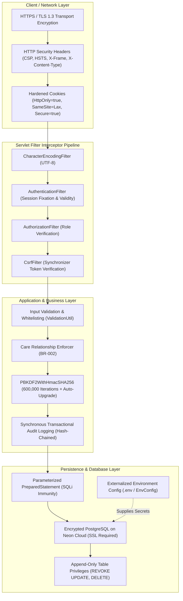

# CareSync — Authentication & Security Architecture

**Document Version:** 1.1.0  
**Status:** Approved for Implementation  
**Standard:** Modern Defense-in-Depth Web Application Security (OWASP 2024 Guidelines)  
**Author:** Senior Security Architect & Backend Engineer  

---

## 1. Security Architecture Principles

CareSync handles sensitive patient consultations, health records, and provider scheduling. The system enforces a **Defense-in-Depth** security model across the network, container, application, and persistence layers.

> [!IMPORTANT]
> This document specifies engineering security controls, defensive programming practices, and secure design patterns. It does not certify legal or regulatory statutory compliance (such as HIPAA or GDPR), which requires formal external clinical and legal audits.



---

## 2. Authentication & Credential Management

### 2.1 Password Hashing Architecture
Passphrases must never be stored in plaintext or with outdated hashing algorithms (e.g., MD5, SHA-1, bare SHA-256).

- **Algorithm:** PBKDF2 with HMAC-SHA256 (`PBKDF2WithHmacSHA256`).
- **Baseline Iteration Count:** **`600,000` iterations** (aligning with OWASP Password Storage Guidelines).
- **Configurable Iterations:** Loaded via environment variable `AUTH_PBKDF2_ITERATIONS` (defaults to `600000`), allowing runtime tuning without codebase recompilation.
- **Unique Salt per Password:** Every password generates a unique, cryptographically secure 16-byte random salt using `java.security.SecureRandom`.
- **Derived Key Length:** 256 bits (32 bytes).
- **Storage:** Stored across dedicated columns in the `users` table:
  - `password_hash`: Base64-encoded PBKDF2 hash.
  - `password_salt`: Base64-encoded unique 16-byte salt.
  - `hash_iterations`: Integer storing the iteration count utilized when the hash was generated.

### 2.2 Constant-Time Password Verification Routine
```java
public static boolean verifyPassword(char[] candidatePassword, String storedHashBase64, 
                                     String storedSaltBase64, int iterations) {
    try {
        byte[] salt = Base64.getDecoder().decode(storedSaltBase64);
        byte[] expectedHash = Base64.getDecoder().decode(storedHashBase64);
        
        KeySpec spec = new PBEKeySpec(candidatePassword, salt, iterations, 256);
        SecretKeyFactory factory = SecretKeyFactory.getInstance("PBKDF2WithHmacSHA256");
        byte[] testHash = factory.generateSecret(spec).getEncoded();
        
        // Constant-time comparison to prevent side-channel timing attacks
        return MessageDigest.isEqual(expectedHash, testHash);
    } catch (Exception ex) {
        throw new SecurityException("Password verification failure", ex);
    }
}
```

### 2.3 Transparent Future Password-Hash Upgrades
As computational hardware advances, recommended iteration counts increase. CareSync implements an automated hash migration protocol:
1. When a user authenticates successfully, `UserService` checks:
   ```java
   int targetIterations = EnvConfig.getInt("AUTH_PBKDF2_ITERATIONS", 600000);
   if (user.getHashIterations() < targetIterations) {
       // Transparently rehash password using new target iterations and fresh salt
       String newSalt = PasswordUtil.generateSaltBase64();
       String newHash = PasswordUtil.hashPassword(candidatePassword, newSalt, targetIterations);
       userDao.updatePasswordHash(user.getId(), newHash, newSalt, targetIterations);
       auditService.logEvent("PASSWORD_WORKFACTOR_UPGRADED", user.getId(), connection);
   }
   ```
2. Users are upgraded seamlessly upon normal login without password reset interruptions.

### 2.4 Performance Benchmarking
- At 600,000 iterations on modern multi-core x86/ARM server hardware, PBKDF2-HMAC-SHA256 executes in approximately **150 to 250 milliseconds** per core.
- This computational cost achieves the ideal security-usability trade-off: it introduces negligible latency for an interactive human login while rendering brute-force or dictionary attacks on leaked database dumps economically intractable for attackers.

---

## 3. Session Management & Cookie Hardening

### 3.1 Session Lifecycle & Fixation Protection
1. **Creation:** A new session is initialized only upon successful credential verification.
2. **Session Fixation Prevention:**
   ```java
   // Invalidate pre-login session and provision brand-new session identifier
   HttpSession oldSession = request.getSession(false);
   if (oldSession != null) {
       oldSession.invalidate();
   }
   HttpSession newSession = request.getSession(true);
   newSession.setAttribute("USER_PRINCIPAL", userPrincipal);
   ```
3. **Session Inactivity Timeout:** Configured to strictly 30 minutes in `web.xml`.
4. **Hardened Cookie Attributes:**
   - **`HttpOnly = true`:** Inaccessible to client-side scripts, neutralizing session hijacking via Cross-Site Scripting (XSS).
   - **`SameSite = Lax`:** Restricts cookie transmission on cross-origin subrequests, providing foundational Cross-Site Request Forgery (CSRF) mitigation.
   - **`Secure = true`:** Cookie is only transmitted over encrypted TLS/HTTPS connections. (Configurable via `caresync.security.cookie.secure` in development).

---

## 4. Authorization & Role-Based Access Control (RBAC)

### 4.1 Filter-Based Enforcement
Role verification is centrally enforced by `AuthorizationFilter` before any controller is reached:
- Route `/patient/*`: Requires `userPrincipal.role() == Role.PATIENT`
- Route `/doctor/*`: Requires `userPrincipal.role() == Role.DOCTOR`
- Route `/admin/*`: Requires `userPrincipal.role() == Role.ADMIN`

Any violation immediately returns **HTTP 403 Forbidden** or redirects to a generic access-denied view, while synchronously recording an `UNAUTHORIZED_ACCESS_ATTEMPT` event.

### 4.2 Clinical Record Authorization Boundary (BR-002)
To prevent Insecure Direct Object References (IDOR):
- **Patients** can only access appointments, medical records, and prescriptions where `record.patient_id == loggedInPatient.id`.
- **Doctors** cannot query arbitrary patient records. A doctor is permitted to view a patient's historical records only if:
  1. The doctor has an active, confirmed appointment scheduled with that patient, OR
  2. The doctor was the author of that medical record.

---

## 5. Cross-Site Request Forgery (CSRF) Protection

All state-modifying requests (`POST`, `PUT`, `DELETE`) require a valid synchronizer CSRF token:
1. Upon session initialization, `CsrfFilter` generates a cryptographically strong 32-byte UUID token:
   ```java
   String csrfToken = UUID.randomUUID().toString();
   session.setAttribute("CSRF_TOKEN", csrfToken);
   ```
2. JSP views embed the token in hidden inputs:
   ```html
   <input type="hidden" name="_csrf" value="${sessionScope.CSRF_TOKEN}" />
   ```
3. `CsrfFilter` intercepts `POST` requests and compares the submitted `_csrf` parameter with `session.getAttribute("CSRF_TOKEN")`.
4. If the token is missing or mismatched, the request is aborted with **HTTP 403 Forbidden**.

---

## 6. Injection Defense & Data Sanitization

### 6.1 SQL Injection (SQLi) Prevention
- Every SQL interaction must use `java.sql.PreparedStatement` with typed placeholders (`?`).
- **Strict Rule:** Direct string concatenation in SQL queries (`"SELECT * FROM users WHERE email = '" + email + "'"` ) is strictly prohibited.
- Example:
  ```java
  String sql = "SELECT user_id, email, password_hash, password_salt, hash_iterations, role, status " +
               "FROM users WHERE email = ?";
  try (PreparedStatement stmt = connection.prepareStatement(sql)) {
      stmt.setString(1, email.trim().toLowerCase());
      try (ResultSet rs = stmt.executeQuery()) {
          // Process results safely
      }
  }
  ```

### 6.2 Cross-Site Scripting (XSS) Prevention
- **Output Escaping:** Dynamic data rendered in JSP views is escaped using JSTL `<c:out value="${model.attribute}" />` or EL `fn:escapeXml()`.
- **Content Security Policy (CSP):** Emitted via `SecurityHeadersFilter`:
  ```http
  Content-Security-Policy: default-src 'self'; script-src 'self' https://cdn.jsdelivr.net; style-src 'self' https://cdn.jsdelivr.net; img-src 'self' data:; font-src 'self' https://cdn.jsdelivr.net;
  X-Content-Type-Options: nosniff
  X-Frame-Options: DENY
  Referrer-Policy: strict-origin-when-cross-origin
  ```

---

## 7. Synchronous Transactional Audit Logging & Append-Only Storage

### 7.1 Prevention of Audit Log Loss
Critical security and clinical events (appointment booking, cancellations, medical record submissions, credential changes) **must not be processed asynchronously**, because container restarts, thread pool saturation, or unhandled exceptions could cause audit entries to be silently discarded.

- **Synchronous Transactional Inclusion:**
  Critical audit records are written using the **same JDBC Connection and inside the same transaction** (`connection.setAutoCommit(false)`) as the operation itself.
  - If the primary operation succeeds, the audit log commits atomically.
  - If the primary operation fails or rolls back, the phantom audit log rolls back with it.

### 7.2 Database-Level Append-Only Privilege Separation
To enforce tamper resistance at the database layer:
```sql
-- Grant only INSERT and SELECT on audit_logs to application role
GRANT SELECT, INSERT ON audit_logs TO caresync_app;

-- Explicitly revoke destructive permissions
REVOKE UPDATE, DELETE, TRUNCATE ON audit_logs FROM caresync_app;
```
Even if an attacker gains application-level administrative execution or executes unauthorized SQL through an application flaw, the database engine strictly prohibits altering or deleting past audit logs.

### 7.3 Cryptographic Hash Chaining
Each audit entry computes a SHA-256 hash chaining back to the previous entry:
```
log_hash = SHA256(prev_log_hash + user_id + action + target_id + timestamp)
```
Any out-of-band manipulation of database rows invalidates the cryptographic hash chain, enabling automated detection of log tampering.

---

## 8. Environment Configuration & Secret Management

- Credentials (database URL, user, password) are loaded from server environment variables or a local `.env` file via `EnvConfig.java`.
- A template `.env.example` is committed to the repository; the real `.env` file is excluded via `.gitignore`.
- Database connection strings include SSL parameters (`sslmode=require`) to guarantee in-transit encryption to Neon Cloud.
