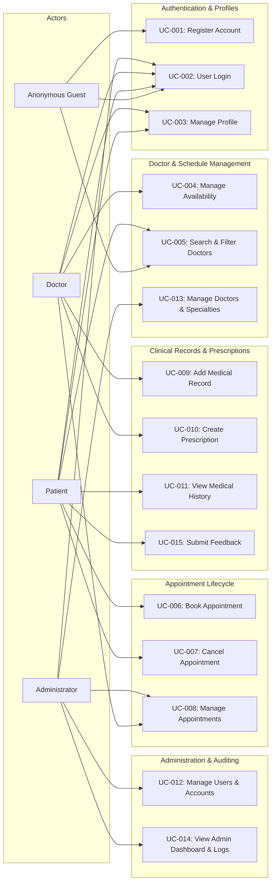

# CareSync — Use Case Analysis & Specifications

**Document Version:** 1.0.0  
**Status:** Approved for Implementation Planning  
**Target Platform:** Java 21, Jakarta EE 10, Neon PostgreSQL  
**Author:** Senior Software Architect & Engineering Team  

---

## 1. Use Case Model Overview

CareSync supports three authenticated primary actors (**Administrator**, **Doctor**, and **Patient**) alongside an unauthenticated guest actor (**Anonymous User**). The interactions between actors and core system functional boundary modules are modeled in the diagram below.

---

## 2. Comprehensive Use Case Specifications

---

### UC-001: Patient Registration
- **Use Case ID:** `UC-001`
- **Use Case Name:** Patient Self-Registration
- **Primary Actor:** Anonymous Guest (prospective patient)
- **Description:** Allows a new patient to register an account in the CareSync portal by providing personal, contact, and basic medical information.
- **Preconditions:** Guest is on the CareSync landing/registration page and not currently logged in.
- **Main Flow:**
  1. Guest accesses the `/register` URL.
  2. System renders the Patient Registration Form.
  3. Guest enters email, password, password confirmation, full name, phone number, date of birth, gender, and blood group.
  4. Guest submits the form.
  5. System validates client input (format, password strength >= 8 characters with letters/numbers, valid email syntax).
  6. System checks that the email address is not already registered.
  7. System generates a secure 16-byte cryptographic salt and hashes the password via PBKDF2WithHmacSHA256.
  8. System begins database transaction:
     - Inserts record into `users` table with role `PATIENT` and status `ACTIVE`.
     - Inserts profile record into `patient_profiles` referencing `user_id`.
     - Inserts record into `audit_logs` capturing `USER_REGISTERED`.
  9. System commits transaction.
  10. System establishes an authenticated session or redirects to `/login` with a success alert: "Account created successfully. Please sign in."
- **Alternative Flow (Auto-Login):**
  - At step 10, system automatically provisions an active HTTP session and redirects the patient directly to `/patient/dashboard`.
- **Exception Flow:**
  - *Duplicate Email (Step 6):* System displays an inline error: "An account with this email address already exists."
  - *Validation Failure (Step 5):* Form re-renders with specific error banners highlighting invalid fields; password fields are wiped.
  - *Database Error (Step 8):* Transaction is rolled back; system renders user-friendly error: "Registration service is temporarily unavailable. Please try again."
- **Postconditions:** A new user record with role `PATIENT` and corresponding `patient_profiles` record are persisted.

---

### UC-002: User Login & Session Initialization
- **Use Case ID:** `UC-002`
- **Use Case Name:** User Login & Authentication
- **Primary Actor:** Registered User (Patient, Doctor, Administrator)
- **Description:** Authenticates user credentials and provisions a role-scoped HTTP session.
- **Preconditions:** User has a registered account.
- **Main Flow:**
  1. User navigates to `/login`.
  2. System presents the unified CareSync login page.
  3. User enters email and password, and submits the form.
  4. System fetches user record from database by email.
  5. System verifies password hash against stored PBKDF2 hash and salt.
  6. System validates account status is `ACTIVE`.
  7. System invalidates any previous session ID (to avoid session fixation) and creates a new `HttpSession`.
  8. System attaches user identity DTO (`userId`, `role`, `fullName`, `email`) and a cryptographically random CSRF token to the session.
  9. System records `LOGIN_SUCCESS` in `audit_logs`.
  10. System redirects the user to their role-specific dashboard:
      - Admin -> `/admin/dashboard`
      - Doctor -> `/doctor/dashboard`
      - Patient -> `/patient/dashboard`
- **Alternative Flow (Remember Email):**
  - User checks "Remember My Email"; system writes an encrypted cookie containing only the email address for pre-populating future forms.
- **Exception Flow:**
  - *Invalid Credentials (Step 4/5):* System increments failed login count, records `LOGIN_FAILED` in `audit_logs`, and returns error: "Invalid email or password."
  - *Inactive or Suspended Account (Step 6):* System returns: "Your account has been deactivated. Please contact the administrator."
- **Postconditions:** User is authenticated and a secure session is active.

---

### UC-003: Doctor Profile Management
- **Use Case ID:** `UC-003`
- **Use Case Name:** Doctor Profile Management
- **Primary Actor:** Doctor
- **Description:** Enables a doctor to manage their professional biography, contact details, clinic room, and consultation fee.
- **Preconditions:** Doctor is authenticated and session role is `DOCTOR`.
- **Main Flow:**
  1. Doctor navigates to `/doctor/profile`.
  2. System displays current profile data (qualifications, bio, consultation fee, office number, specialty name).
  3. Doctor modifies editable attributes (bio, fee, phone, office/room).
  4. Doctor submits changes.
  5. System validates fee >= 0 and non-empty contact info.
  6. System updates `doctor_profiles` and `users` tables.
  7. System logs `DOCTOR_PROFILE_UPDATED` in `audit_logs`.
  8. System displays confirmation banner: "Profile updated successfully."
- **Alternative Flow:**
  - Doctor also changes password by providing current password and confirmed new password.
- **Exception Flow:**
  - *Invalid Fee Format:* System rejects negative values or non-numeric input and preserves user draft.
- **Postconditions:** Doctor's public and internal profile data is updated.

---

### UC-004: Doctor Availability & Time-Off Management
- **Use Case ID:** `UC-004`
- **Use Case Name:** Manage Doctor Availability & Exceptions (Time-Off/Holidays)
- **Primary Actor:** Doctor, Administrator
- **Description:** Allows doctors to set up recurring weekly hours (shift start/end, slot durations) and schedule specific availability exceptions (full-day leaves, partial-day unavailability, conference travel, or clinic holidays).
- **Preconditions:** Doctor is logged in with an active account; or Administrator managing clinic holidays.
- **Main Flow (Regular Schedule & Exceptions):**
  1. Doctor opens `/doctor/availability`.
  2. System displays current weekly template from `doctor_availability` and upcoming leaves from `doctor_availability_exceptions`.
  3. Doctor can modify recurring hours: days of practice, shift hours (09:00 to 17:00), and slot duration (e.g., 30 minutes).
  4. Doctor clicks "Add Time Off / Leave".
  5. Doctor enters exception date, leave type (`LEAVE`, `SICK`, `CONFERENCE`, `EMERGENCY`), full-day toggle, or specific partial-day time interval (`start_time` to `end_time`), and optional reason.
  6. Doctor saves configuration.
  7. System validates:
     - Shift start is before shift end.
     - Slot duration divides shift evenly.
     - Partial leave start time is before end time.
     - No existing confirmed appointments conflict with the scheduled leave (or warns doctor to reschedule first).
  8. System inserts or updates records in `doctor_availability` and `doctor_availability_exceptions` tables within a transaction.
  9. System synchronously logs `AVAILABILITY_EXCEPTION_CREATED` in `audit_logs`.
  10. System displays success alert: "Schedule and time-off updated successfully."
- **Alternative Flow (Clinic-Wide Holidays by Admin):**
  - Administrator navigates to `/admin/settings/holidays` and inserts an exception with `doctor_id = NULL` and `exception_type = 'HOLIDAY'`. The date is instantly blocked for all doctors across the clinic.
- **Exception Flow:**
  - *Conflict with Existing Active Bookings:* If the doctor attempts to take leave on a date where active `CONFIRMED` appointments exist, system alerts: "You have 2 booked appointments on this date. Please reschedule or cancel them before booking time off."
- **Postconditions:** Availability rules and exception windows are committed; booking engine dynamically computes open slots excluding exception intervals.

---

### UC-005: Search & Filter Doctors
- **Use Case ID:** `UC-005`
- **Use Case Name:** Search and Filter Doctors
- **Primary Actor:** Patient, Anonymous Guest
- **Description:** Search the doctor directory by specialty, doctor name, consultation fee range, or availability.
- **Preconditions:** None (accessible publicly or within patient portal).
- **Main Flow:**
  1. User navigates to `/doctors` or `/patient/doctors`.
  2. System displays search bar and filter criteria (Specialty dropdown, Search query, Fee slider, Day of week).
  3. User applies filter (e.g., Specialty = "Cardiology").
  4. System queries database joining `doctor_profiles`, `users`, and `specialties`, filtering where `is_active = true`.
  5. System displays matching doctor cards with name, specialty, qualification, experience, fee, and average star rating.
  6. User clicks "View Profile" on a doctor card.
  7. System renders the Doctor Profile and dynamic appointment booking calendar.
- **Alternative Flow:**
  - No search filters applied: System displays all active doctors sorted by rating and name.
- **Exception Flow:**
  - *No Matches Found:* System displays friendly empty state: "No doctors found matching your criteria. Try adjusting your filters."
- **Postconditions:** User is presented with matching doctor profiles and bookable calendar.

---

### UC-006: Book Appointment
- **Use Case ID:** `UC-006`
- **Use Case Name:** Book Doctor Appointment
- **Primary Actor:** Patient
- **Description:** Enables a patient to select an open slot, enter symptoms/reason for consultation, and confirm a booking.
- **Preconditions:** Patient is logged in; doctor has active schedule.
- **Main Flow:**
  1. Patient selects a doctor and views available dates.
  2. Patient clicks a date; system calculates and renders available 30-minute time slots (excluding existing booked slots).
  3. Patient selects a slot (e.g., 2026-11-20 10:00 AM).
  4. Patient enters consultation reason or symptoms.
  5. Patient clicks "Confirm Appointment".
  6. System initiates database transaction:
     - Obtains a transactional row lock on doctor schedule (`SELECT ... FOR UPDATE`).
     - Verifies requested date does not fall on a doctor leave or clinic holiday in `doctor_availability_exceptions`.
     - Confirms slot falls within doctor weekly hours and is free.
     - Inserts record into `appointments` with `slot_range = tsrange(...)` and status `CONFIRMED` (or `PENDING`).
     - Database GiST exclusion constraint (`ex_no_overlapping_doctor_appointments`) validates range non-overlap at storage engine level.
     - Inserts alert into `notifications` table for the doctor.
     - Inserts confirmation into `notifications` for the patient.
     - Synchronously writes record into `audit_logs` in the same transaction.
  7. Transaction commits.
  8. System renders confirmation page with unique Appointment Reference Number.
- **Alternative Flow (Concurrent Conflict / Race Condition):**
  - If another patient simultaneously books an overlapping slot, the PostgreSQL GiST exclusion constraint raises `23P01` (exclusion violation). System catches the exception, rolls back transaction cleanly, and returns: "This slot has just been reserved by another patient. Please choose an alternate slot."
- **Exception Flow:**
  - *Patient Double-Booking:* If the patient already has an active appointment with another doctor at the same date and time, system blocks the request: "You already have an appointment scheduled at this time."
- **Postconditions:** A new appointment is committed to the database; doctor and patient are notified.

---

### UC-007: Cancel Appointment
- **Use Case ID:** `UC-007`
- **Use Case Name:** Cancel Appointment
- **Primary Actor:** Patient, Doctor, Administrator
- **Description:** Allows an actor to cancel a previously scheduled appointment subject to business constraints.
- **Preconditions:** Appointment exists in status `PENDING` or `CONFIRMED`.
- **Main Flow (Patient Cancellation):**
  1. Patient navigates to `/patient/appointments`.
  2. Patient selects an upcoming appointment and clicks "Cancel Appointment".
  3. System checks that the appointment start time is more than 2 hours in the future.
  4. System prompts patient to select or type a cancellation reason.
  5. Patient confirms cancellation.
  6. System executes database transaction:
     - Updates `appointments.status` to `CANCELLED`.
     - Records `cancellation_reason` and `cancelled_by_user_id`.
     - Generates in-app notification for the assigned doctor.
     - Logs event in `audit_logs`.
  7. Transaction commits.
  8. System displays message: "Your appointment has been cancelled successfully."
- **Alternative Flow (Doctor/Admin Cancellation):**
  - Doctor or Admin cancels the appointment; no 2-hour restriction applies. Notification is dispatched to patient with the explanation note.
- **Exception Flow:**
  - *Under 2-Hour Limit (Patient):* System rejects cancellation: "Appointments cannot be cancelled online within 2 hours of the scheduled time. Please call the clinic directly."
  - *Already Completed or Cancelled:* System rejects request: "This appointment cannot be cancelled because it is already completed or cancelled."
- **Postconditions:** Appointment status is updated to `CANCELLED`; the time slot becomes available for future bookings.

---

### UC-008: Manage Appointments
- **Use Case ID:** `UC-008`
- **Use Case Name:** Manage Assigned Appointments
- **Primary Actor:** Doctor
- **Description:** Allows a doctor to review daily/weekly appointments, approve pending requests, view patient details, and mark no-shows.
- **Preconditions:** Doctor is logged in.
- **Main Flow:**
  1. Doctor navigates to `/doctor/appointments`.
  2. System presents tabbed view: "Today's Schedule", "Upcoming", and "Completed / History".
  3. Doctor filters appointments by date or status (`CONFIRMED`, `PENDING`).
  4. Doctor selects an appointment to inspect patient name, age, gender, contact number, and reason for visit.
  5. For pending requests, doctor clicks "Approve" (status becomes `CONFIRMED`) or "Decline" (status becomes `CANCELLED`).
  6. Doctor can click "Start Consultation" to proceed with clinical note taking (transitions to UC-009).
- **Alternative Flow (Mark No-Show):**
  - If appointment time has elapsed and patient did not arrive, doctor marks status as `NO_SHOW`.
- **Exception Flow:**
  - *Unauthorized Access:* Attempting to access an appointment belonging to another doctor is blocked with HTTP 403 Forbidden.
- **Postconditions:** Appointment status and history are updated accordingly.

---

### UC-009: Add Medical Record
- **Use Case ID:** `UC-009`
- **Use Case Name:** Add Consultation Medical Record
- **Primary Actor:** Doctor
- **Description:** Doctors document clinical examination findings, symptoms, diagnosis, and treatment plan.
- **Preconditions:** Doctor is assigned to the appointment; appointment is `CONFIRMED`.
- **Main Flow:**
  1. Doctor opens the active appointment and clicks "Document Consultation".
  2. System displays the Medical Record Form.
  3. Doctor enters:
     - Chief Complaint / Symptoms
     - Physical Examination Observations
     - Diagnosis (Primary and Secondary)
     - Clinical Recommendations & Notes
  4. Doctor attaches prescription items if medication is needed (see UC-010).
  5. Doctor submits the record.
  6. System begins database transaction:
     - Inserts record into `medical_records`.
     - Updates appointment status to `COMPLETED`.
     - Notifies patient that their consultation notes and prescription are available.
     - Logs event in `audit_logs`.
  7. Transaction commits.
  8. System renders confirmation and printable summary.
- **Exception Flow:**
  - *Empty Diagnosis:* System alerts: "Diagnosis is mandatory before completing consultation."
- **Postconditions:** Clinical record is permanently stored and linked to patient history.

---

### UC-010: Create Prescription
- **Use Case ID:** `UC-010`
- **Use Case Name:** Create Digital Prescription
- **Primary Actor:** Doctor
- **Description:** Authors a structured prescription with multiple medications linked to an appointment.
- **Preconditions:** Doctor is authoring a medical record for a valid appointment.
- **Main Flow:**
  1. Within the consultation interface, doctor selects "Add Prescription".
  2. Doctor clicks "Add Medication" and enters:
     - Medicine Name (e.g., Amoxicillin 500mg)
     - Dosage (e.g., 1 tablet)
     - Frequency (e.g., Three times daily after meals)
     - Duration (e.g., 7 days)
     - Special Instructions (e.g., Complete full course)
  3. Doctor can add multiple medication rows.
  4. Doctor enters general advice or dietary guidelines.
  5. Doctor submits form.
  6. System begins database transaction:
     - Inserts parent row into `prescriptions`.
     - Inserts child rows into `prescription_items`.
  7. Transaction commits.
  8. System generates a clean, printable prescription view.
- **Exception Flow:**
  - *Missing Drug Details:* System validates that each item row has non-empty name and dosage.
- **Postconditions:** Prescription record and individual medication items are saved.

---

### UC-011: View Medical History
- **Use Case ID:** `UC-011`
- **Use Case Name:** View Patient Medical History
- **Primary Actor:** Patient, Authorized Doctor
- **Description:** Accesses chronological clinical records, diagnoses, and past prescriptions.
- **Preconditions:**
  - If Patient: Viewing own records.
  - If Doctor: Has an active or prior appointment with this patient.
- **Main Flow:**
  1. Actor navigates to Medical History view (`/patient/records` or `/doctor/patient-records?patientId=X`).
  2. System checks access rights (enforces BR-002 care relationship boundary).
  3. System retrieves historical records ordered by date descending.
  4. Actor can expand individual consultations to view:
     - Date & Doctor Name / Specialty
     - Diagnosis & Clinical Notes
     - Prescribed Medications & Dosage
  5. Actor can click "Print Prescription" for a clean printable layout.
- **Exception Flow:**
  - *Access Violation (Doctor browses arbitrary patient):* System returns HTTP 403 Forbidden and logs security violation in `audit_logs`.
- **Postconditions:** Complete historical health data is rendered securely.

---

### UC-012: Manage Users & Accounts
- **Use Case ID:** `UC-012`
- **Use Case Name:** Administrative User Management
- **Primary Actor:** Administrator
- **Description:** Search, inspect, activate, deactivate, or reset account credentials for patients and staff.
- **Preconditions:** Administrator is logged in with `ADMIN` role.
- **Main Flow:**
  1. Admin opens `/admin/users`.
  2. System displays paginated table of users with filters: Role (`PATIENT`, `DOCTOR`, `ADMIN`), Status (`ACTIVE`, `INACTIVE`, `SUSPENDED`), and search query.
  3. Admin selects a user to view full profile details and registration date.
  4. Admin can toggle status (e.g., deactivate a delinquent account).
  5. System persists status update in `users` table and creates `audit_logs` record.
  6. System displays success alert: "User status updated successfully."
- **Exception Flow:**
  - *Self-Deactivation Attempt:* Admin attempts to deactivate their own account; system rejects operation: "Administrators cannot deactivate their own account."
- **Postconditions:** User status is updated; deactivated users are immediately blocked from logging in.

---

### UC-013: Manage Doctors & Specialties
- **Use Case ID:** `UC-013`
- **Use Case Name:** Manage Doctors and Specialties
- **Primary Actor:** Administrator
- **Description:** Provision new doctor profiles, manage licensing credentials, and organize medical specialties.
- **Preconditions:** Administrator is authenticated.
- **Main Flow:**
  1. Admin navigates to `/admin/doctors`.
  2. Admin can create new specialties (e.g., "Orthopedics", "Cardiology") or manage existing ones.
  3. Admin clicks "Register New Doctor".
  4. Admin fills in personal details, selects specialty, enters license number, experience, and initial consultation fee.
  5. System validates uniqueness of email and medical license.
  6. System creates records in `users` and `doctor_profiles` within a database transaction.
  7. System logs `DOCTOR_PROVISIONED` in `audit_logs`.
  8. System displays confirmation banner.
- **Exception Flow:**
  - *Duplicate License Number:* System rejects creation: "Medical license number already registered."
- **Postconditions:** New doctor profile is active and ready for scheduling.

---

### UC-014: View Admin Dashboard & Logs
- **Use Case ID:** `UC-014`
- **Use Case Name:** View Executive Admin Dashboard & Audit Logs
- **Primary Actor:** Administrator
- **Description:** Real-time analytics dashboard with metric cards, appointment volume charts, and tamper-evident audit logs.
- **Preconditions:** Administrator is authenticated.
- **Main Flow:**
  1. Admin navigates to `/admin/dashboard`.
  2. System queries database to calculate summary statistics:
     - Total registered patients
     - Total active doctors
     - Today's appointment count (by status: pending, confirmed, completed)
     - Total completed consultations
  3. System renders interactive Chart.js graphs (Weekly Appointment Trends, Specialty Distribution).
  4. Admin navigates to `/admin/audit-logs`.
  5. System displays chronological audit trail (Timestamp, Actor, Action, Target Entity, IP Address).
  6. Admin filters audit logs by action type or date range.
- **Postconditions:** Real-time system health and governance data are visually rendered.

---

### UC-015: Submit Feedback
- **Use Case ID:** `UC-015`
- **Use Case Name:** Submit Patient Feedback
- **Primary Actor:** Patient
- **Description:** Allows a patient to rate their consultation experience with a doctor following a completed appointment.
- **Preconditions:** Patient is logged in; appointment status is `COMPLETED`; no feedback previously submitted for this appointment.
- **Main Flow:**
  1. Patient navigates to `/patient/appointments` and selects a completed appointment.
  2. Patient clicks "Leave Feedback".
  3. System renders 5-star rating selector and comments textarea.
  4. Patient selects rating (1 to 5) and enters textual review.
  5. Patient submits feedback.
  6. System validates rating between 1 and 5.
  7. System initiates database transaction:
     - Inserts record into `feedback` table.
     - Recalculates doctor's average rating and total review count in `doctor_profiles`.
     - Logs event in `audit_logs`.
  8. Transaction commits.
  9. System renders message: "Thank you for your feedback!"
- **Exception Flow:**
  - *Duplicate Feedback:* If user attempts to resubmit, unique constraint on `appointment_id` triggers rollback and error: "Feedback has already been submitted for this appointment."
- **Postconditions:** Feedback is persisted and doctor's aggregate rating is updated.

